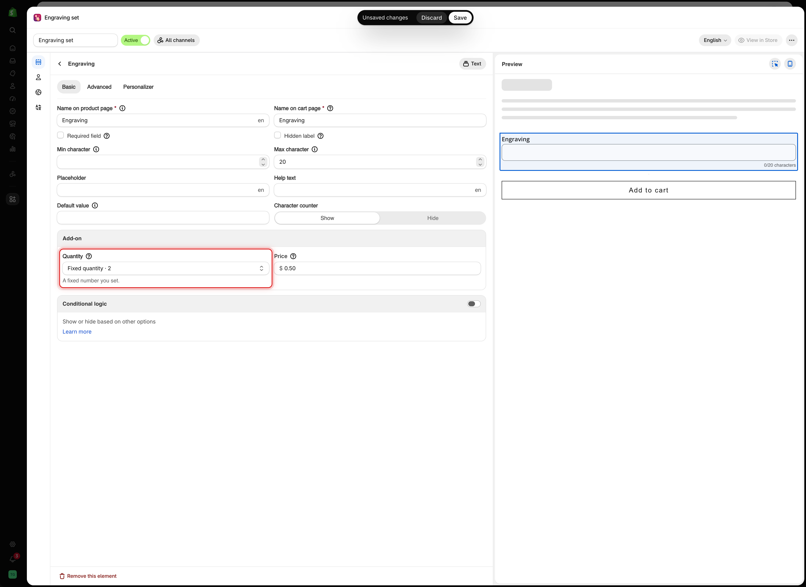
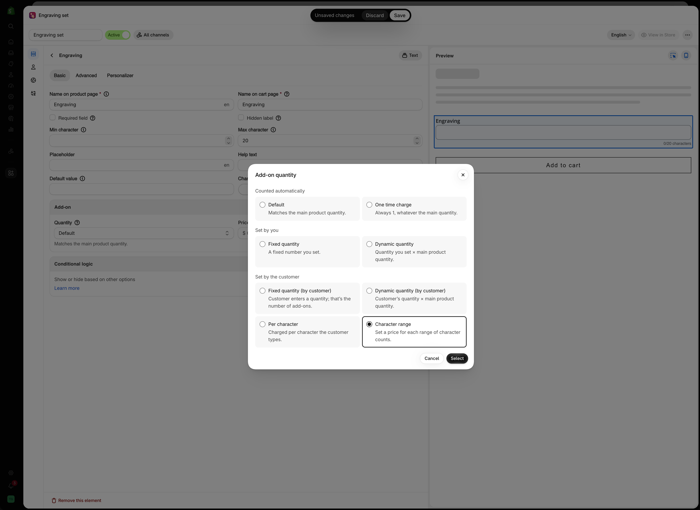
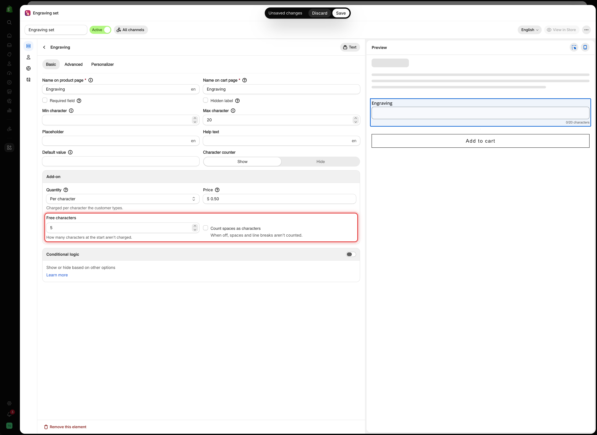
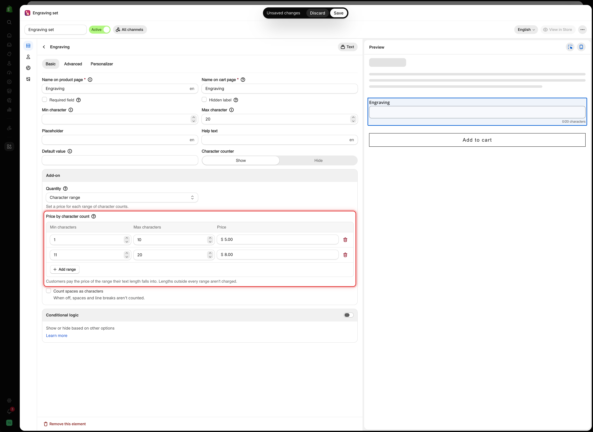
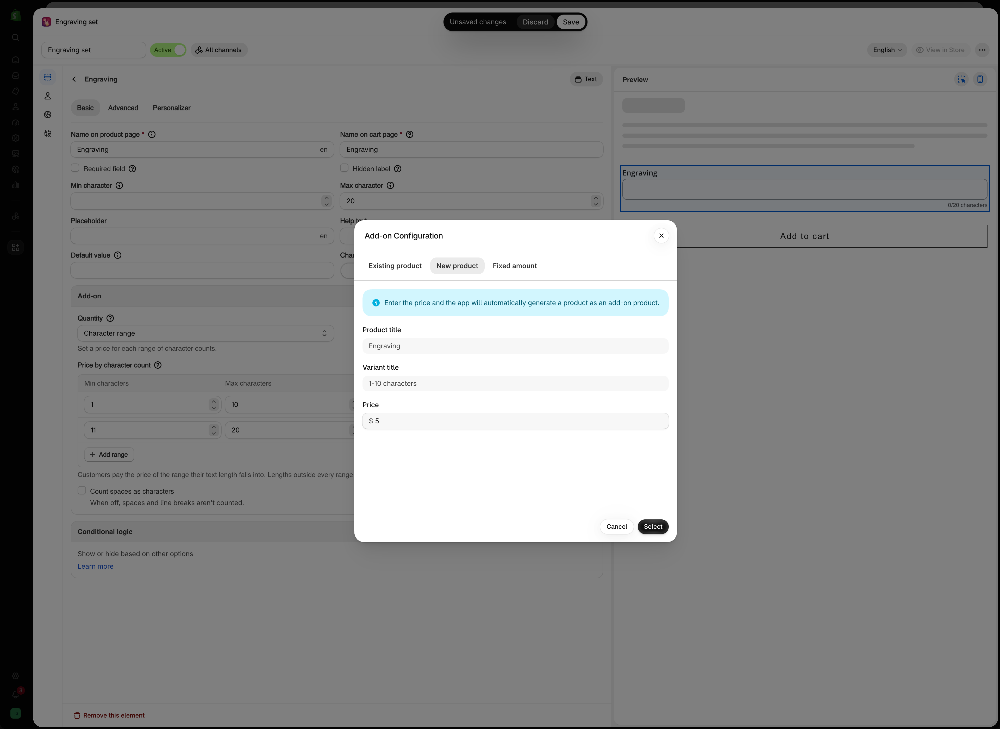

# Advanced add-on modes

The price sets how much an add-on costs. The add-on quantity mode sets how many of it are charged.

For example, a $5.00 gift wrap charge on an order of three items is either $15.00 or $5.00, depending on the mode you select.

## Where it is

Open the option, go to the **Basic** tab, and find the **Add-on** card. The **Quantity** field shows the mode in use, with a one-line description below it. For the two **Set by you** modes, it also shows the number, for example `Fixed quantity · 2`.

Select the field to open the **Add-on quantity** dialog. Pick a mode, enter a **Quantity** if the mode needs one, and select **Select**.

The mode is set at **option** level, even when prices are set on individual values, and it applies to the whole option. It has no effect on an option with no price, which is what the field's tooltip means by "Only works if option has additional charges."

<figure><figcaption>
The Quantity field shows the mode in use, plus the number for the Set by you modes.
</figcaption></figure>

## The nine modes

The dialog groups them under three headings, by who decides the quantity: **Counted automatically**, **Set by you**, and **Set by the customer**.

<table><thead><tr><th width="210">Group</th><th width="240">Mode</th><th width="200">Quantity comes from</th><th>Available on</th></tr></thead><tbody><tr><td rowspan="2"><strong>Counted automatically</strong></td><td><strong>Default</strong></td><td>The main product's quantity</td><td>Everything with a price</td></tr><tr><td><strong>One time charge</strong></td><td>Always 1</td><td>Everything with a price</td></tr><tr><td rowspan="2"><strong>Set by you</strong></td><td><strong>Fixed quantity</strong></td><td>A number you set</td><td>Everything with a price</td></tr><tr><td><strong>Dynamic quantity</strong></td><td>A number you set × main quantity</td><td>Everything with a price</td></tr><tr><td rowspan="5"><strong>Set by the customer</strong></td><td><strong>Fixed quantity (by customer)</strong></td><td>A number the customer enters</td><td>Everything with a price</td></tr><tr><td><strong>Dynamic quantity (by customer)</strong></td><td>The customer's number × main quantity</td><td>Everything with a price</td></tr><tr><td><strong>Mixed quantity</strong></td><td>A number per option value, entered by the customer</td><td>Multi-select options only</td></tr><tr><td><strong>Per character</strong></td><td>How many characters were typed</td><td><a href="../option-types/input-types/text.md">Text</a> and <a href="../option-types/input-types/textarea.md">Textarea</a> only</td></tr><tr><td><strong>Character range</strong></td><td>A price per range of text lengths</td><td><a href="../option-types/input-types/text.md">Text</a> and <a href="../option-types/input-types/textarea.md">Textarea</a> only</td></tr></tbody></table>

The two **Set by you** modes are the only ones that show the **Quantity** field in the dialog.

<figure><figcaption>
The Add-on quantity dialog groups the modes by who decides the quantity. Per character and Character range appear on Text and Textarea only.
</figcaption></figure>


**One time charge**, **Fixed quantity**, and **Fixed quantity (by customer)** cannot be used with a [Fixed amount](add-price-directly.md) or [Percentage](percentage.md) price. The dialog greys them out with the note **Not available with Fixed amount.**, which covers Percentage too. If one of them was already selected, the **Add-on** card shows a warning with a **Switch to Default** button. Use [New product](auto-generate-a-product.md) or [Existing product](use-an-existing-product.md) for those modes.


## Worked calculations

In the following examples, the add-on price is **$4.00**, and the customer is buying **3** of the main product.

### Default

The add-on quantity follows the main product's quantity.

> 3 × $4.00 = **$12.00**

Use this for an add-on used once per item, such as an engraved plate per bracelet or fabric per cushion.

### One time charge

The add-on is charged once, regardless of the main product quantity.

> 1 × $4.00 = **$4.00**

Use this for a charge applied once per order, such as gift wrapping a parcel, a delivery upgrade, or a setup fee.

### Fixed quantity

The quantity is always the number you enter in **Quantity**, regardless of the main product quantity. With **Quantity** set to `2`:

> 2 × $4.00 = **$8.00**

Use this when the add-on always includes a fixed amount, such as a gift box with two ribbons.

### Dynamic quantity

The **Quantity** value multiplied by the main product quantity. With **Quantity** set to `2`:

> 2 × 3 × $4.00 = **$24.00**

Use this when each main item needs a fixed number of the add-on, such as two batteries per flashlight.

### Fixed quantity (by customer)

A quantity field is displayed below the option. The customer's value is used as entered. If the customer enters `5`:

> 5 × $4.00 = **$20.00**

Use this when the customer chooses the quantity independently of how many products they are buying, such as extra embroidered names or spare buttons.

### Dynamic quantity (by customer)

The customer's value multiplied by the main product quantity. If the customer enters `5`:

> 5 × 3 × $4.00 = **$60.00**

Use this when the customer's value applies to each item, for example, five extra names on each of three jerseys.


This mode multiplies twice, so the total increases quickly. State in the option's label that the value applies per item, and set a **Max value** on the quantity.


### Mixed quantity

Each option value has its own quantity field. This mode is available on multi-select options only: [Checkbox](../option-types/selection-types/checkbox.md), or any selection type with **Allow multiple** enabled.

If a customer selects two of `Chocolate` and one of `Vanilla`, both priced at $4.00:

> (2 × $4.00) + (1 × $4.00) = **$12.00**

Use this for mix-and-match add-ons such as toppings, flavors, or items in a hamper.

### Per character

The charge is based on the number of characters the customer enters. This mode is available on Text and Textarea only. Selecting it adds two settings to the **Add-on** card:

<table><thead><tr><th width="250">Setting</th><th width="120">Default</th><th>What it does</th></tr></thead><tbody><tr><td><strong>Free characters</strong></td><td><code>0</code></td><td>How many characters at the start aren't charged</td></tr><tr><td><strong>Count spaces as characters</strong></td><td>Off</td><td>When off, spaces and line breaks aren't counted</td></tr></tbody></table>

<figure><figcaption>
Per character adds Free characters and Count spaces as characters below the price.
</figcaption></figure>

At $0.50 per character, `Forever yours` has 12 characters without its space:

> 12 × $0.50 = **$6.00**

With **Free characters** set to `5`, only 7 of them are charged:

> (12 − 5) × $0.50 = **$3.50**

Use this for engraving and embroidery priced by length. **Free characters** suits offers such as "the first five letters are included".

In the cart and on the order, the option shows only the text the customer typed, such as `Forever yours`, without a character count after it.


Always use **Per character** together with a [Max character](../option-types/shared-settings/limits.md#min-and-max-character) limit, so the charge has a maximum. Enable the [Character counter](../option-types/shared-settings/limits.md#character-counter) so the customer can see how many characters they have entered.


### Character range

You set a price for each range of text lengths, and the customer pays the price of the range their text falls into. This mode is available on Text and Textarea only.

Selecting it replaces the **Price** field with a **Price by character count** table:

<table><thead><tr><th width="250">Column</th><th>What it holds</th></tr></thead><tbody><tr><td><strong>Min characters</strong></td><td>The shortest length in the range, starting from 1</td></tr><tr><td><strong>Max characters</strong></td><td>The longest length in the range</td></tr><tr><td><strong>Price</strong></td><td>The add-on for that range. It opens the same <strong>Add-on Configuration</strong> dialog as any price. Choose <strong>Existing product</strong>, <strong>New product</strong>, or <strong>Fixed amount</strong>. <strong>Percentage</strong> is not offered for ranges</td></tr></tbody></table>

<figure><figcaption>
Each row is a range of text lengths with its own price. The table replaces the single Price field.
</figcaption></figure>

Select **Add range** for another row. A new row starts right after the highest range, five characters long. The card also has **Count spaces as characters**, off by default. **Free characters** is not available in this mode.

With these ranges:

<table><thead><tr><th width="250">Range</th><th>Price</th></tr></thead><tbody><tr><td>1 to 10 characters</td><td>$5.00</td></tr><tr><td>11 to 20 characters</td><td>$8.00</td></tr></tbody></table>

`Forever yours` has 12 characters without its space, so it falls into the second range. The range price is charged once per item, like **Default**. For 3 items:

> 3 × $8.00 = **$24.00**

Use this for flat price tiers, such as "up to 10 letters" and "up to 20 letters", where a per-letter price would feel fiddly.

The table checks your ranges as you type:

<table><thead><tr><th width="290">Message</th><th>Meaning</th></tr></thead><tbody><tr><td><strong>Overlaps another range.</strong></td><td>Two ranges share a length. Fix it before saving</td></tr><tr><td><strong>Lengths … aren't in any range, so they won't be charged.</strong></td><td>There is a gap between ranges, or nothing after the last one</td></tr><tr><td><strong>Outside the text length limit (… characters), so this range never applies.</strong></td><td>The range falls outside the option's <strong>Min character</strong> and <strong>Max character</strong></td></tr><tr><td><strong>Add at least one range.</strong></td><td>The table is empty</td></tr></tbody></table>


Lengths outside every range aren't charged. Cover every length your **Max character** limit allows, or customers can type past your last range for free.


With **New product**, the app creates one product for the option, with one variant per range. The **Variant title** is filled in for you, like `1-10 characters`.

<figure><figcaption>
For a range priced as New product, the variant title is the range itself.
</figcaption></figure>

## Choosing the right mode

<table><thead><tr><th width="330">The add-on is…</th><th>Mode</th></tr></thead><tbody><tr><td>Consumed once per item bought</td><td><strong>Default</strong></td></tr><tr><td>Per order, such as wrapping, delivery, or a setup fee</td><td><strong>One time charge</strong></td></tr><tr><td>A set amount that comes with the product</td><td><strong>Fixed quantity</strong></td></tr><tr><td>A set amount per item</td><td><strong>Dynamic quantity</strong></td></tr><tr><td>However many the customer wants, in total</td><td><strong>Fixed quantity (by customer)</strong></td></tr><tr><td>However many the customer wants, per item</td><td><strong>Dynamic quantity (by customer)</strong></td></tr><tr><td>Pick-and-mix across several values</td><td><strong>Mixed quantity</strong></td></tr><tr><td>Priced by each letter of the text</td><td><strong>Per character</strong></td></tr><tr><td>Priced in tiers by text length</td><td><strong>Character range</strong></td></tr></tbody></table>

## Common mistake

Leaving a per-order charge such as gift wrap on **Default**.

If a customer buys five bracelets and selects gift wrapping, the **Default** mode charges for five wraps.

Use **One time charge** for anything applied once per order, including delivery upgrades, gift wrapping, handling fees, artwork setup, and rush production.

## Notes

* The mode is set per option. If values in one option need different quantities, use two options with conditional logic, or use **Mixed quantity**.
* **Mixed quantity** is displayed only when the option is multi-select.
* **Per character** and **Character range** are available on Text and Textarea only.
* Hidden options are not charged, regardless of the mode.
* An add-on with a **default value** is charged as soon as the page loads. With the **Default** mode, the charge also multiplies by the product quantity.
