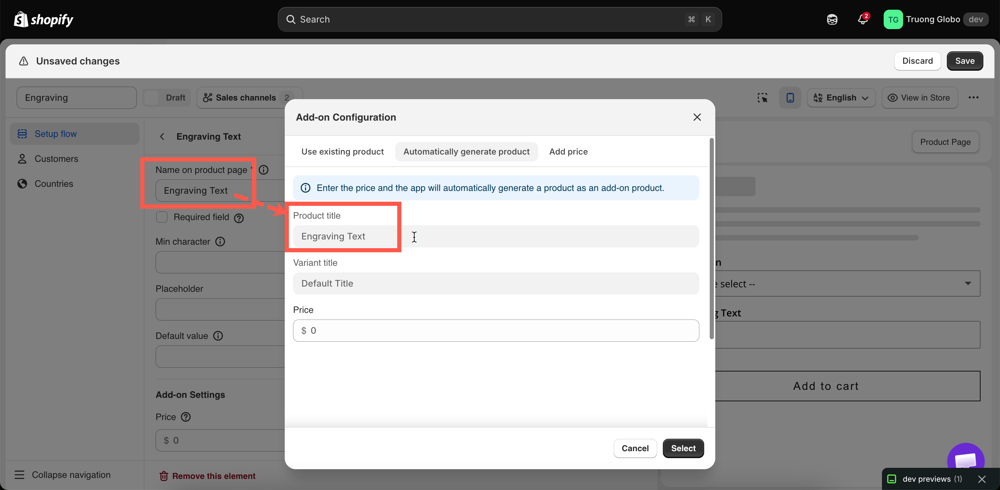

# New product

You enter a price, and the app creates a Shopify product for the add-on. The add-on then has inventory, a SKU, a weight, POS support, and its own line in your Shopify reports, without you building the product manually.

This is the recommended mode for most physical add-ons.

## Steps



### Open the price field and choose the New product tab

**Price** in the **Add-on** card on an input type, or the **Price** cell on an option value's row for a selection type.



### Check the titles, then enter the price

**Product title** and **Variant title** are displayed but cannot be edited. The product title comes from the option's **Label**. The variant title comes from the option value's name, or from the option itself on an input type.

Set a clear **Label** before you generate the product. `Frame color` produces a readable product name, while `Select` does not.

Enter the price in your store's currency, such as `10` or `1.50`. A comma works as the decimal mark too. The price must be above zero, and a price the app cannot read shows **Enter a valid price, like 10 or 1.50.** If your currency has no decimals, enter a whole number, such as `1500`.



### Select Select, then Save the option set

The product is created on Shopify after you save, not while the dialog is open. While it runs, the price field shows **Creating add-on product on Shopify…**, or **Updating add-on product on Shopify…** when you change a price later. Once it is done, a **Product** column in the values table links to the product in Shopify admin.

If Shopify rejects a product, the field shows **Not saved on Shopify** and a banner lists the add-ons under **Some add-on products weren't saved on Shopify**. Fix them, then save again or use **Sync Add-on data** from the editor's more-actions menu.

A price the app cannot save blocks **Save** with an error on the field, so a wrong price never reaches your storefront.



### Set up its inventory

**Do not skip this step.** Without inventory tracking, out-of-stock behavior has no effect. See [Turning on stock tracking](auto-generate-a-product.md#turning-on-stock-tracking) below.



<figure><figcaption>
The titles come from your option, so name the option well before generating.
</figcaption></figure>

## What the app creates

The following table describes the products you will find in your catalog.

<table><thead><tr><th width="230">Property</th><th>Value</th></tr></thead><tbody><tr><td>Title</td><td>The option's <strong>Label</strong></td></tr><tr><td>Variants</td><td>One per priced option value, named after that value. An input type gets a single variant</td></tr><tr><td>Status</td><td><strong>Unlisted</strong>. Products the app created before this change are <strong>Active</strong></td></tr><tr><td>Sales channels</td><td>Online Store and Point of Sale, so it can be purchased through the widget</td></tr><tr><td>Tags</td><td><code>globo-product-options</code>, plus an identifier for the option it belongs to</td></tr><tr><td>Inventory policy</td><td>Set to continue selling when out of stock — so by default it never blocks a sale</td></tr></tbody></table>


Use the `globo-product-options` tag to quickly find all generated products and exclude them from automated collections. In Shopify, search your products by this tag to view all generated products in one place.


One product is created per option, with one variant for each priced value. For example, an [Image swatch](../option-types/selection-types/image-swatch.md) with twelve priced fabrics creates one product with twelve variants, not twelve products. Options with a large number of priced values are split across several products.

## Turning on stock tracking

Generated products are created so that they never block a sale. This is the safe default, but it means **out-of-stock behavior has no effect until you enable inventory tracking**.

1. **Open the product in Shopify admin.** Use the **Product** link in the values table, or search your products for the `globo-product-options` tag.
2. **Turn on inventory tracking** on the variant and enter your quantity.
3. **Set it to stop selling when out of stock**, so Shopify does not keep selling past zero.
4. **Set the option's** [**Out of stock options**](../option-types/shared-settings/out-of-stock-options.md) to **Hide**, **Blur**, or **Strike-through**.
5. **Test it.** Set the quantity to zero and check that the value is displayed as you configured on the storefront.

For more information, see [Stock and inventory](stock-and-inventory.md).

## Keeping them out of the way

New add-on products are created as **Unlisted**. Shopify keeps unlisted products out of collections, storefront search, and product recommendations, while they can still be bought through the widget. There is nothing to set up.

Add-on products created before this change are **Active**, so they can still appear when customers browse. Change their status to **Unlisted** in Shopify admin, or use the fixes below.

<table><thead><tr><th width="290">Problem with an Active add-on product</th><th>Fix</th></tr></thead><tbody><tr><td>It appears in automated collections</td><td>Add a condition to those collections excluding the tag <code>globo-product-options</code></td></tr><tr><td>It appears in storefront search</td><td>Exclude it in whatever controls your search — a search app's settings, or your theme's search template</td></tr><tr><td>It appears in a sitemap or feed</td><td>Exclude it by tag in the tool that builds it</td></tr><tr><td>It clutters your product list in admin</td><td>Filter or sort by tag. There is no need to delete them</td></tr></tbody></table>


Do not set add-on products to **Draft** or **Archived**, and do not remove them from the Online Store. Customers can then no longer add them to the cart, which breaks the add-on. **Unlisted** is the status that hides them and keeps them purchasable.


## When to use this mode

<table><thead><tr><th width="330">Use it when</th><th>Use something else when</th></tr></thead><tbody><tr><td>The add-on is physical and you want to count it</td><td>It is a service with nothing to count — <a href="add-price-directly.md">Fixed amount</a></td></tr><tr><td>You do not already sell it separately</td><td>You do — <a href="use-an-existing-product.md">Existing product</a></td></tr><tr><td>You sell in person through POS</td><td>Never <strong>Fixed amount</strong> for POS</td></tr><tr><td>You want add-ons in your Shopify reporting</td><td></td></tr><tr><td>The add-on has weight that affects shipping</td><td></td></tr></tbody></table>

Examples

**Gift wrap with real stock**

<table><thead><tr><th width="290">Setting</th><th>Value</th></tr></thead><tbody><tr><td>Option</td><td><code>Gift wrap</code>, a Checkbox with one value</td></tr><tr><td>Price</td><td><strong>New product</strong> $3.00</td></tr><tr><td>Add-on quantity</td><td><strong>One time charge</strong></td></tr><tr><td>After saving</td><td>Turn on inventory tracking, enter your box count, set the policy to stop selling at zero</td></tr><tr><td>Out of stock options</td><td><strong>Hide</strong></td></tr></tbody></table>

**Twelve premium colors, each with its own inventory**

A [Color swatch](../option-types/selection-types/color-swatch.md) where each premium value generates a product at its own price. This creates one product with twelve variants and twelve independent inventory counts.

**An engraving plate**

A Text option for the engraving, with a generated product so the metal plate is tracked in inventory.

## Notes

* The product is created in the background after you **save**, so it may take a moment to appear.
* Editing the price in the app updates the generated variant.
* Renaming the option's **Label** does not rename the existing product. The product keeps the title it had when it was created.
* Deleting an option set does **not** delete its generated products. They remain in your catalog. See [Duplicate and delete](../option-sets/duplicate-and-delete.md).
* Duplicating or importing an option set creates new add-on products for the copy. Changing a price in one option set no longer changes it in the other.
* If a generated product is out of sync in the app, use **Sync Add-on data** from the editor's more-actions menu. Unsaved changes are lost when it reloads the add-on data, so save first.
