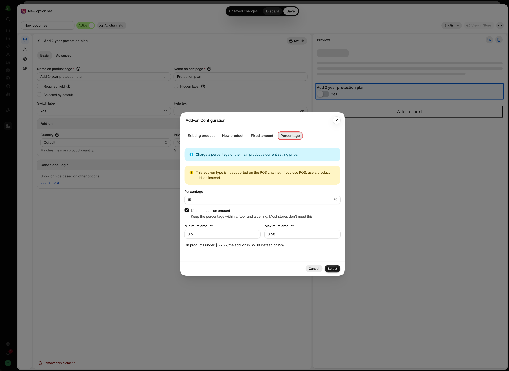
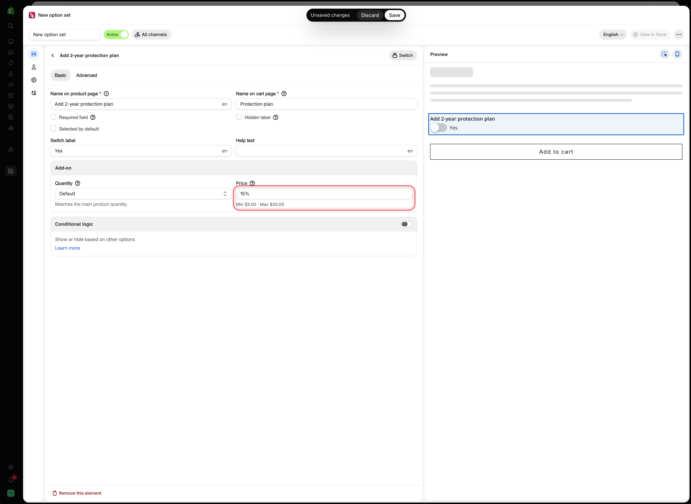
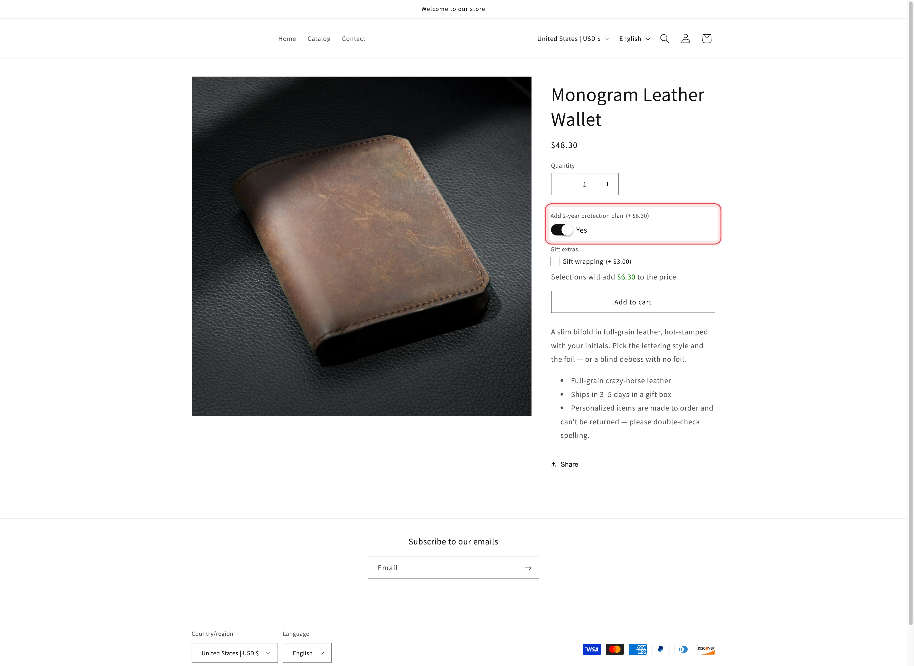

# Percentage

The **Percentage** mode charges a share of the main product's price. A 15% protection plan adds $6.30 to a $42.00 wallet and $18.00 to a $120.00 bag. You enter one number, and the charge follows whichever product and variant the customer picks.

Like [Fixed amount](add-price-directly.md), it raises the price of the main product. No Shopify product is created or linked.

Use it for charges that should grow with the price of the item, such as protection plans, insurance, rush production, or a premium finish.


Percentage add-ons may not be available on all plans. The in-app **Pricing** page lists them as **Percentage add-ons**. See [Compare plans](../plans-and-billing/compare-plans.md).


## Steps



### Open the price field

On an input type, that is **Price** in the **Add-on** card on the **Basic** tab. On a selection type, it is the **Price** cell on the option value's row. See [Where you can set add-ons](where-you-can-set-add-ons.md).



### Choose the Percentage tab

The **Add-on Configuration** dialog has four tabs. **Percentage** is the fourth.

Two notes appear at the top. The first confirms that the add-on is a percentage of the main product's current selling price. The second warns that this add-on type is not supported on the POS channel.



### Enter the percentage

Type the number without the `%` sign, for example `15`. Decimals are accepted.

The percentage must be greater than 0, or the dialog shows **Enter a percentage greater than 0.** and **Select** stays disabled. Above 100, the dialog warns **This add-on costs more than the product itself.** You can still save it. The warning is there to catch a typo such as `150` instead of `15`.



### Optionally, limit the add-on amount

Select **Limit the add-on amount** to keep the charge between a floor and a ceiling. Most stores do not need this. Two fields appear, both in your store's currency:

<table><thead><tr><th width="250">Field</th><th>What it does</th></tr></thead><tbody><tr><td><strong>Minimum amount</strong></td><td>The add-on never costs less than this. Leave it empty for no minimum</td></tr><tr><td><strong>Maximum amount</strong></td><td>The add-on never costs more than this. Leave it empty for no maximum</td></tr></tbody></table>

With a minimum set, a line below the fields tells you where it takes over, for example **On products under $33.33, the add-on is $5.00 instead of 15%.**

The minimum cannot be higher than the maximum. If it is, the dialog shows **Minimum must be less than or equal to maximum.**

<figure><figcaption>
The Percentage tab, with a 15% add-on kept between $5.00 and $50.00.
</figcaption></figure>



### Select Select

The dialog closes. The price field shows the percentage, such as `15%`, with no currency sign. If you set a minimum or maximum, they are shown below the field, for example `Min $5.00 · Max $50.00`.

<figure><figcaption>
After you select it, the Price field shows the percentage and its limits.
</figcaption></figure>



### Set how it scales

In the **Add-on** card, the **Quantity** field sets how many times the charge is applied. Three modes cannot be used with Percentage, the same three as with Fixed amount. See [What it cannot do](percentage.md#what-it-cannot-do) below and [Advanced add-on modes](advanced-add-on-modes.md).



### Save and test on your storefront

Open a product the option set is assigned to and select the option. The amount beside it is the percentage of that product's price. The charge is applied at checkout. See [How pricing is applied](how-pricing-is-applied.md).



## How the amount is worked out

The percentage is taken from the main product's current selling price: the price of the variant the customer has selected, for one item.

* **It follows the variant.** When the customer switches to a variant with a different price, the add-on amount beside the option changes with it.
* **Other add-ons are not included.** A 15% protection plan on a $42.00 wallet is $6.30, even if the customer also adds $3.00 gift wrapping.
* **The minimum and maximum come last.** The app works out the percentage, then raises it to the minimum or lowers it to the maximum.
* **Amounts are rounded to the nearest cent.**
* **Other currencies.** When a customer shops in another currency, the percentage is taken from the price they see. The minimum and maximum are set in your store's currency and converted.

With **15%**, a **$5.00** minimum, and a **$50.00** maximum:

<table><thead><tr><th width="250">Variant price</th><th width="200">15% of it</th><th>Charged</th></tr></thead><tbody><tr><td>$20.00</td><td>$3.00</td><td><strong>$5.00</strong>, the minimum</td></tr><tr><td>$42.00</td><td>$6.30</td><td><strong>$6.30</strong></td></tr><tr><td>$400.00</td><td>$60.00</td><td><strong>$50.00</strong>, the maximum</td></tr></tbody></table>

## What the customer sees

The option shows the add-on as an amount of money, such as `(+ $6.30)`, not as a percentage. The format comes from your store-wide settings. Depending on those settings, the product price on the page also updates to include it. See [Add-on price display settings](price-display-settings.md).

<figure><figcaption>
A 15% protection plan on a $42.00 wallet shows as + $6.30, and the product price updates to $48.30.
</figcaption></figure>

There is **no separate cart line**. The charge is added to the main item's price, so the cart shows one line at the higher amount, with the option details listed below it.

## What it cannot do


**Three quantity modes are unavailable with Percentage**, the same three as with Fixed amount:

* **One time charge**
* **Fixed quantity**
* **Fixed quantity (by customer)**

In the **Add-on quantity** dialog, those three are greyed out with the note *Not available with Fixed amount.* The note names Fixed amount, but it applies to Percentage too. If one of them is already set when you open the **Percentage** tab, a warning tells you to change the add-on quantity first, and **Select** stays disabled.

To charge something once per order, use [New product](auto-generate-a-product.md) with **One time charge** instead.



**No Shopify POS support.** Percentage add-ons do not work in the Shopify POS app. If an option set is published to the POS channel, use one of the product-backed modes instead. See [POS limitations](../point-of-sale/limitations.md).

**No inventory, and no out-of-stock handling.** There is no product to track, so the [Out of stock options](../option-types/shared-settings/out-of-stock-options.md) setting has no effect.


A percentage cannot be negative, even on stores that allow negative add-on prices. Like Fixed amount, this mode has no SKU, no weight, and no separate line in your Shopify product reports.

**Not for Character range prices.** The price dialog of each range in a [Character range](advanced-add-on-modes.md#character-range) table also shows the **Percentage** tab, but a range priced this way is not charged on the storefront. Price each range with **Fixed amount**, **New product**, or **Existing product**.

## Percentage or Fixed amount?

<table><thead><tr><th width="330">The charge should…</th><th>Use</th></tr></thead><tbody><tr><td>Grow with the price of the item, such as a warranty or insurance</td><td><strong>Percentage</strong></td></tr><tr><td>Be the same on every product, such as a $5.00 engraving fee</td><td><a href="add-price-directly.md">Fixed amount</a></td></tr><tr><td>Grow with the price, but never be tiny or huge</td><td><strong>Percentage</strong> with <strong>Limit the add-on amount</strong></td></tr><tr><td>Track stock, ship as its own item, or work in POS</td><td><a href="auto-generate-a-product.md">New product</a> or <a href="use-an-existing-product.md">Existing product</a></td></tr></tbody></table>

## Examples

**A protection plan with a floor and a ceiling**

<table><thead><tr><th width="290">Setting</th><th>Value</th></tr></thead><tbody><tr><td>Option</td><td><code>Add 2-year protection plan</code>, a Switch</td></tr><tr><td>Price</td><td><strong>Percentage</strong> 15%, minimum $5.00, maximum $50.00</td></tr><tr><td>Add-on quantity</td><td><strong>Default</strong>, one plan per item</td></tr></tbody></table>

**Two plan lengths**

A Radio button with `1 year` at 8% and `2 years` at 15%, both using **Percentage**. Each value has its own percentage.

**Rush production**

A Switch labeled `Rush production` at 20%, so a rush order on a large print costs more than on a small one.

## Notes

* The same option set can mix modes. One value can use **Percentage** while another uses **Existing product**.
* A percentage attached to a **default value** is charged as soon as the page loads. See [Required field and default value](../option-types/shared-settings/required-and-default-value.md#default-value).
* A hidden option is not charged. Hiding an option with a conditional rule removes its charge from the total.
* On a multi-select option, every selected value with a percentage is charged, each worked out from the main product's price.
