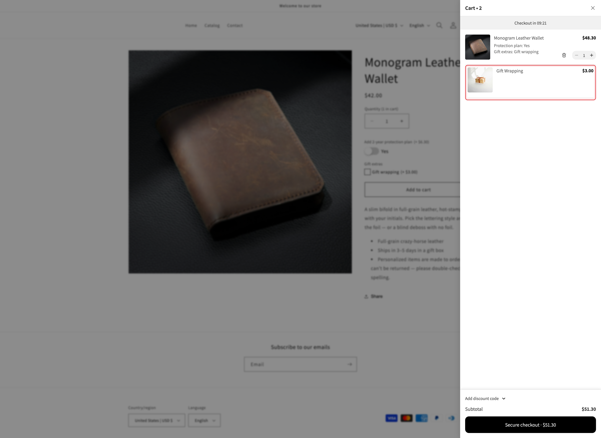

# Essent Cart Drawer

[Essent Cart Drawer Cart Upsell](https://apps.shopify.com/essential-cart-drawer) is recognized automatically. There is nothing to connect and no selector to enter.


**Set it up first.** The two settings to change are the same for every cart drawer app, and they are on [Cart drawer apps](./#set-up). This page covers what is specific to Essent.


## Add-on lines in the drawer

Each add-on that is backed by a product shows as its own line in the Essent drawer, right below the item it belongs to. On those lines, the app hides the quantity selector, the Remove button, and Essent's variant selector, so an add-on cannot be changed, swapped, or removed apart from its item.

The main item keeps all three. When the customer changes its quantity in the drawer, the add-on quantities follow it, according to each add-on's [quantity mode](../../add-on-pricing/advanced-add-on-modes.md). Removing the main item removes its add-ons with it.

[Fixed amount](../../add-on-pricing/add-price-directly.md) and [Percentage](../../add-on-pricing/percentage.md) add-ons have no line of their own. They are included in the main item's price.

<figure><figcaption>
In the Essent drawer, the Gift Wrapping add-on line has no quantity selector or delete icon. The wallet keeps both, and its $48.30 price includes a 15% protection plan.
</figcaption></figure>

## The sticky add-to-cart bar checks your options

Essent can show a sticky bar with its own quantity selector and **Add to cart** button while the customer scrolls the product page. On its own, that button adds the product without the option form, so required options could be skipped.

With the app installed, the sticky bar's button follows the same rules as your product page button:

<table><thead><tr><th width="290">When the customer clicks it</th><th>What happens</th></tr></thead><tbody><tr><td>A required option is empty, or an entry is not valid</td><td>Nothing is added. The page scrolls to the first option that needs attention and shows its error</td></tr><tr><td>Every option is filled in correctly</td><td>The app adds the product with the customer's choices and its add-on lines</td></tr></tbody></table>

The quantity the customer picks in the sticky bar is the one added to the cart, even though the product page has its own quantity box.

There is nothing to turn on for this. It works whenever the sticky bar is enabled in Essent.

## Upsells in the Essent drawer

Essent can recommend products inside the drawer, with a button that adds them in one click.

* **Your generated add-on products are hidden from those recommendations.** The app checks each recommended product after Essent draws the list and hides the ones it created for you. One may show for a moment before it disappears.
* **If every recommendation is hidden, the whole upsell block is hidden too**, so customers do not see an empty heading.
* **Products with options should open the product page.** Turn on **Send cart drawer app upsells to the product page**, and the recommendation's button reads **Choose options** and opens the product page instead. See [Upsells in the drawer skip your option form](./#upsells-in-the-drawer-skip-your-option-form).

Essent's other drawer features, such as its reward bar, free shipping goal, and checkout timer, are Essent's own. They work as usual and are not affected by the app.

## Test it



### Add a product with an add-on from the product page

The Essent drawer shows the main item and its add-on line. The add-on line has no quantity selector, no Remove button, and no variant selector.



### Change the main item's quantity in the drawer

The add-on quantity and the drawer total update to match.



### Use the sticky bar with a required option left empty

Scroll down until the sticky bar appears and click its **Add to cart**. The page scrolls back to the option that needs filling in, and nothing is added.



### Fill in the option, pick a quantity in the sticky bar, and add again

The product is added with its choices and add-ons, in the quantity chosen in the sticky bar.



## Next steps

* [Set up](./#set-up): the two settings, with screenshots
* [What a drawer cannot do](./#what-a-drawer-cannot-do): Edit Options, design previews, and the other limits
* [UpCart](upcart.md), [Monster Cart](monster-cart.md), [Kaching Cart](kaching-cart.md), [Qikify Slide Cart](qikify-slide-cart.md), and [Unicorn Cart Drawer](unicorn-cart-drawer.md): the other recognized cart drawer apps
