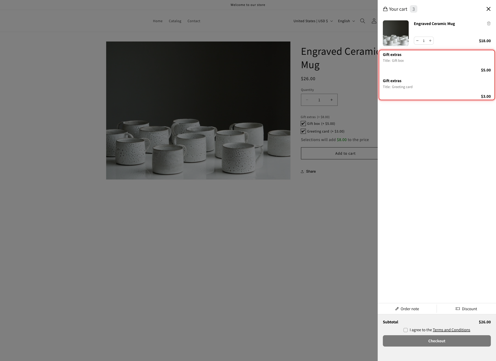

# Qikify Slide Cart

[Qikify Slide Cart Drawer](https://apps.shopify.com/sticky-cart-by-qikify) is recognized automatically. There is nothing to connect and no selector to enter.


**Set it up first.** The two settings to change are the same for every cart drawer app, and they are on [Cart drawer apps](./#set-up). This page covers what is specific to Qikify.


## Add-on lines are locked by Qikify itself

When the page loads, the app tells Qikify which cart lines are add-ons. Qikify then hides the quantity box and the Remove button on those lines in its own drawer, so an add-on cannot be changed or removed apart from the item it belongs to.

If the cart already has items when the page loads, the drawer is refreshed once so those lines are locked too. The main item keeps its own quantity box and Remove button. Removing it removes its add-ons with it.

<figure><figcaption>
In the Qikify drawer, the Gift box and Greeting card add-on lines have no quantity box or Remove button, while the mug they belong to keeps both.
</figcaption></figure>

## The sticky add-to-cart bar checks your options

Qikify can show a sticky bar with its own **Add to cart** button while the customer scrolls the product page. On its own, that button adds the product without the option form, so required options could be skipped.

With the app installed, the sticky bar's button follows the same rules as your product page button:

<table><thead><tr><th width="290">When the customer clicks it</th><th>What happens</th></tr></thead><tbody><tr><td>A required option is empty, or an entry is not valid</td><td>Nothing is added. The page scrolls to the first option that needs attention and shows its error</td></tr><tr><td>Every option is filled in correctly</td><td>The app adds the product with the customer's choices and its add-on lines, then the Qikify drawer opens</td></tr></tbody></table>

There is nothing to turn on for this. It works whenever the sticky bar is enabled in Qikify.

## Upsells in the Qikify drawer

Qikify can recommend products inside the drawer, with a button that adds them in one click.

* **Your generated add-on products are hidden from that list.** The app checks each recommended product after Qikify draws the list and hides the ones it created for you. One may show for a moment before it disappears.
* **Products with options should open the product page.** Turn on **Send cart drawer app upsells to the product page**, and the recommendation's button reads **Choose options** and opens the product page instead. See [Upsells in the drawer skip your option form](./#upsells-in-the-drawer-skip-your-option-form).

Qikify's other drawer extras, such as a gift wrap checkbox or a progress bar, are Qikify's own features. They work as usual and are not affected by the app.

## Test it



### Add a product with an add-on from the product page

The Qikify drawer opens. The add-on line has no quantity box and no Remove button.



### Reload the page and open the drawer again

The add-on line is still locked.



### Use the sticky bar with a required option left empty

Scroll down until the sticky bar appears and click its **Add to cart**. The page scrolls back to the option that needs filling in, and nothing is added.



### Fill in the option and use the sticky bar again

The product is added with its choices and add-ons, and the drawer opens.



## Next steps

* [Set up](./#set-up): the two settings, with screenshots
* [What a drawer cannot do](./#what-a-drawer-cannot-do): Edit Options, design previews, and the other limits
* [UpCart](upcart.md), [Monster Cart](monster-cart.md), and [Kaching Cart](kaching-cart.md): the other recognized cart drawer apps
