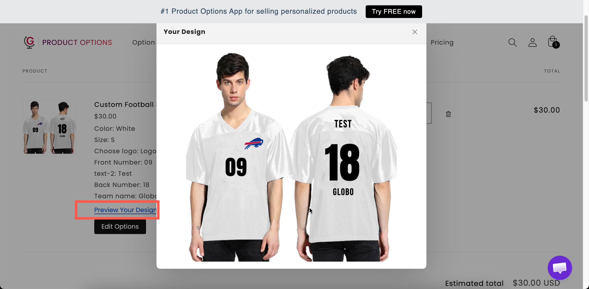

# Designs in cart and orders

When the customer selects **Add to cart**, the app saves an image of their finished design with the cart line, together with everything they entered.

## What the customer sees in the cart

<table><thead><tr><th width="230">In the cart</th><th>What it shows</th></tr></thead><tbody><tr><td>The product image</td><td>The customer's design, so they recognize their item at a glance</td></tr><tr><td>The option details</td><td>The text they typed, the values they picked, and a thumbnail of any uploaded photo</td></tr><tr><td><strong>Preview Your Design</strong></td><td>A link that opens the full design image</td></tr></tbody></table>

<figure><figcaption>
The cart line shows the design, every choice the customer made, and a link to see the design full size.
</figcaption></figure>


**Preview Your Design** appears on your cart page. If you use a [cart drawer app](../integrations/cart-drawer-apps/), customers open the cart page to see the full design.


## Personalizer preview mode

How **Preview Your Design** opens is a store-wide setting: **Settings** > **Settings** > **General** > **Cart page** > **Personalizer preview mode**.

<table><thead><tr><th width="230">Mode</th><th>What happens</th></tr></thead><tbody><tr><td><strong>View in modal</strong> (default)</td><td>The design opens in a window on the cart page</td></tr><tr><td><strong>Download file</strong></td><td>The design downloads as an image file</td></tr></tbody></table>

**View in modal** suits most stores, because customers check the design without leaving the cart. This setting may not be available on all plans. See [Cart page](../storefront-display-and-design/cart-page.md#personalize-preview-mode).

<figure><figcaption>
With View in modal, the customer checks the design without leaving the cart.
</figcaption></figure>

## Letting customers fix a mistake

**Show "Edit Options" button in cart**, under **Settings** > **Settings** > **General** > **Cart page**, lets customers reopen the form from the cart and change their choices, including the design. Without it, a customer who spots a typo has to remove the item and start again. See [Cart page](../storefront-display-and-design/cart-page.md#show-edit-options-button-in-cart).

## What your team sees on the order

The order in Shopify admin lists the item with the customer's choices: the text, the selected values, the font and color, and a link to the uploaded photo.

In the app, the **Orders** page shows the same order with its option summary and files, and can export the design images. See [Order details](../orders/order-details.md).

<table><thead><tr><th width="290">To get the files out</th><th>Use</th></tr></thead><tbody><tr><td>One order at a time</td><td><strong>Download</strong> or <strong>Download all</strong> on the order. See <a href="../orders/order-details.md#files">Order details</a></td></tr><tr><td>Many orders at once</td><td><strong>Export files</strong> with <strong>Personalization previews</strong> ticked. See <a href="../orders/export.md#exporting-files">Export orders and files</a></td></tr><tr><td>Automatically, as orders arrive</td><td><a href="../automations/google-drive-sync/README.md">Google Drive sync</a>, with <strong>Also sync personalizer design images</strong> turned on</td></tr><tr><td>Printed paperwork</td><td>Order emails, invoices, and packing slips. See <a href="../storefront-display-and-design/show-options-on-orders/">Show options on orders</a></td></tr></tbody></table>

Two habits make orders easier to produce:

* **Give each option a clear Name on cart page.** It is the label your team reads on the order. `Engraving text: Forever yours` is clear. `text-1: Forever yours` is not. See [Labels and visibility](../option-types/shared-settings/labels-and-visibility.md).
* **Ask for everything production needs.** If the font matters, offer it in a [Font picker](../option-types/selection-types/font-picker.md) so it is recorded on the order.

## Uploaded files

The customer's original upload is kept with the order, separate from the design image, so you can print from the full-size file.

* State the size you need in the File upload option's [help text](../option-types/shared-settings/placeholder-and-help-text.md#help-text). The design accepts small files that may not print well.
* Turn on the File upload option's image editor so customers crop their photo before uploading. See [File upload](../option-types/input-types/file-upload.md).

## Set expectations about the design

The design is a guide, not a print proof. Screens are not color-calibrated, and final placement can vary slightly. Add help text such as "The preview is a guide. Colors may vary slightly from your screen."

For expensive items, offer a proof before production, for example with a [Switch](../option-types/input-types/switch.md) labeled `Email me a proof first`.

## Notes

* Add-on products appear as their own cart lines unless you merge them. See [Merge main product and add-ons](../add-on-pricing/merge-as-bundle.md).
* Orders keep the option names they were placed with. Renaming an option later does not change past orders.
* The **Preview Your Design** wording can be translated under **Settings > Translations**.
