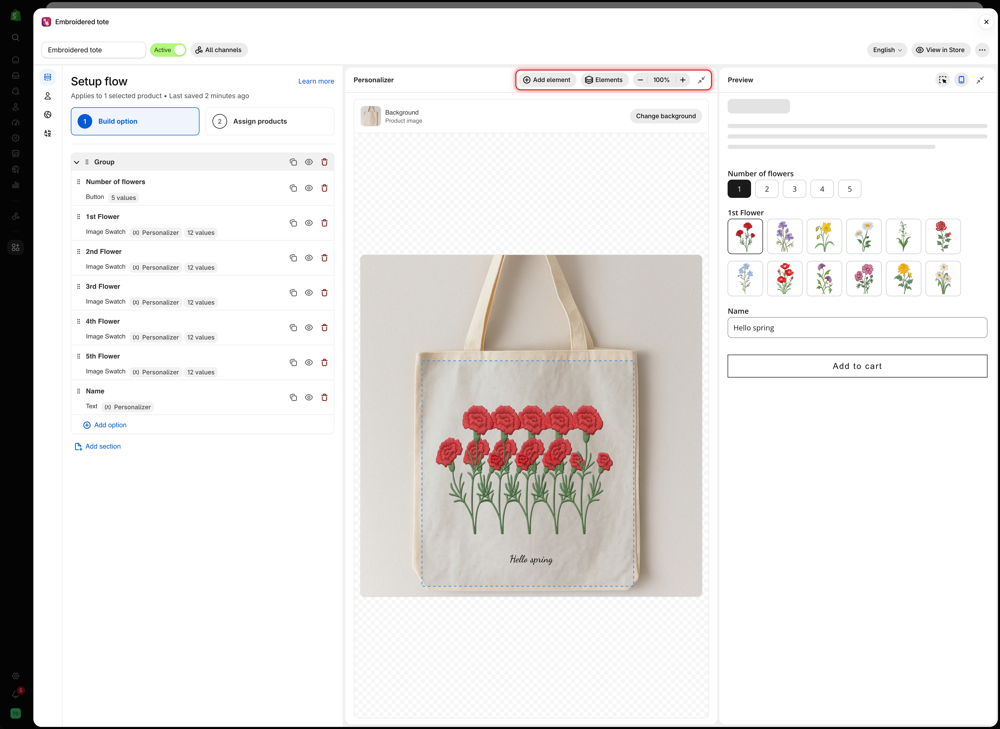
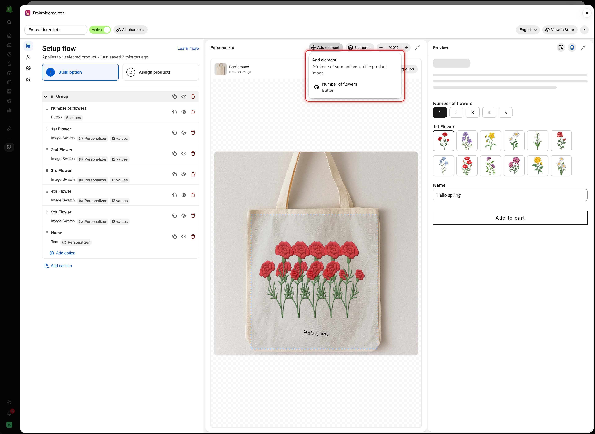
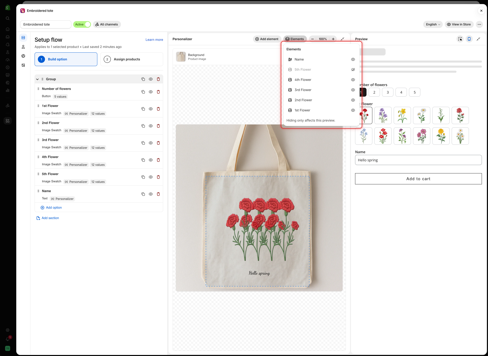
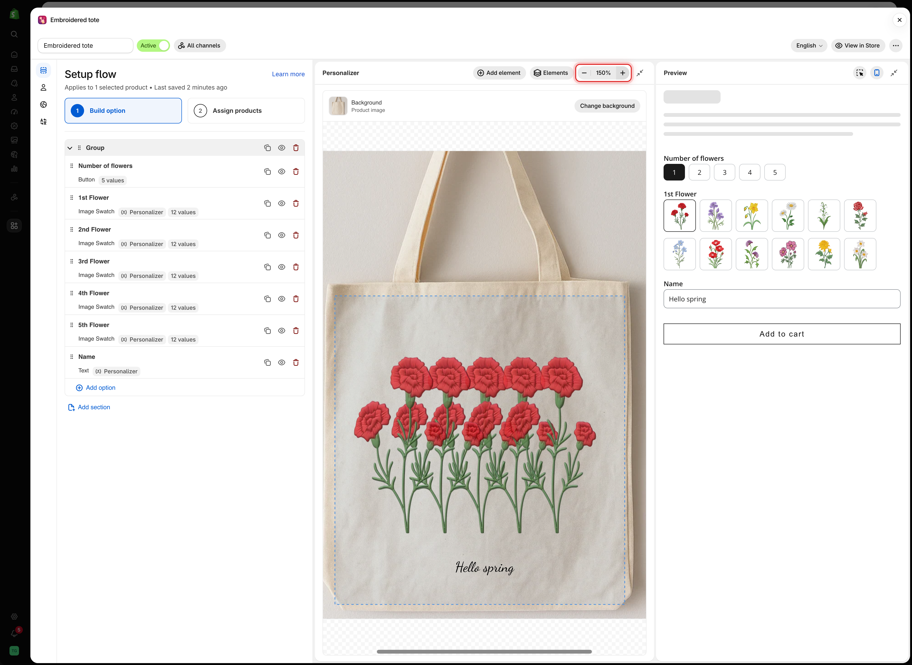
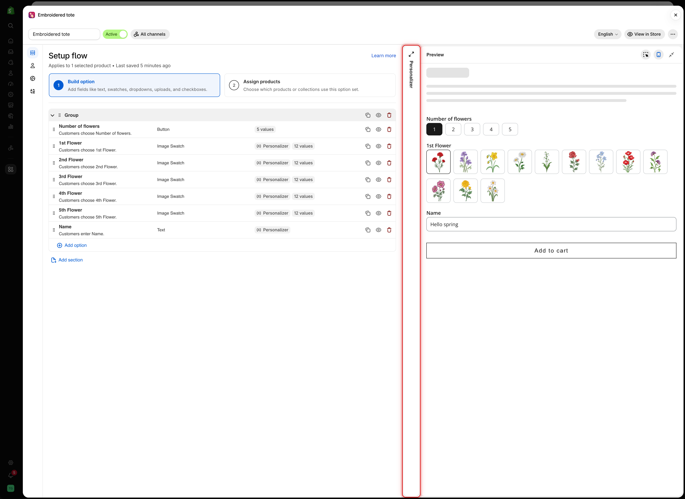
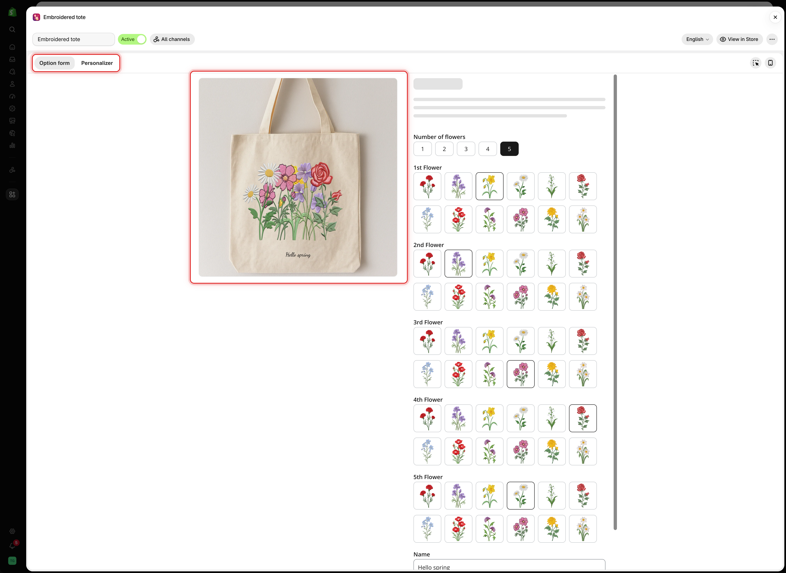

# The Personalizer editor

The Personalizer editor shows your background image with every printed option drawn on it. You select an element and drag it into place, and the values on its **Personalizer** tab update to match.

## Before you start

* At least one option with the **Personalizer** switch on in its **Personalizer** tab. The editor appears once the first option is turned on. See [Set up the Personalizer](setup.md).

## Where the editor appears

<table><thead><tr><th width="290">Screen</th><th>Layout</th></tr></thead><tbody><tr><td>Wide screen, preview in mobile view</td><td>Three panels side by side: the settings panel, the <strong>Personalizer</strong> editor, and the <strong>Preview</strong></td></tr><tr><td>Smaller screen, or preview in desktop view</td><td>Two tabs at the top of the preview: <strong>Option form</strong> and <strong>Personalizer</strong></td></tr></tbody></table>

<figure><figcaption>
On a wide screen, the Personalizer editor sits between the settings panel and the Preview, with its toolbar at the top.
</figcaption></figure>

## The toolbar

<table><thead><tr><th width="230">Control</th><th>What it does</th></tr></thead><tbody><tr><td><strong>Add element</strong></td><td>Prints another option on the product image</td></tr><tr><td><strong>Elements</strong></td><td>Lists every printed option, top element first</td></tr><tr><td><strong>Zoom out</strong>, <strong>Zoom in</strong></td><td>Changes the zoom between 50% and 200%</td></tr><tr><td><strong>Fit to view</strong></td><td>The percentage between the zoom buttons. Select it to return to 100%</td></tr><tr><td><strong>Collapse Personalizer</strong></td><td>Folds the editor into a narrow strip. Wide screens only</td></tr></tbody></table>

Below the toolbar, the **Background** row shows the current background and a **Change background** button. See [Choosing the background](setup.md#choosing-the-background).

### Add element

**Add element** lists the options in the form that can be printed but are not printed yet. Pick one and the app turns its Personalizer on with default settings, selects it on the canvas, and opens its **Personalizer** tab.

<figure><figcaption>
Add element only lists options that are not on the image yet.
</figcaption></figure>

When every supported option is already printed, the menu shows **Every option that can be printed is already on the image.**

### Elements

**Elements** lists the printed options, with the element drawn on top first. Select a name to select that element and open its settings.

The eye icon next to a name hides the element in the editor and the preview only. Use it to reach an element that sits under another one. Customers still see it. An option that is hidden in the form shows a **Hidden** badge instead.

<figure><figcaption>
Elements lists the printed options top to bottom. A dimmed name is hidden in this preview only.
</figcaption></figure>

### Zoom

Zoom in to place small elements precisely, such as a monogram or a name on a narrow strap. Scroll inside the canvas to move around the zoomed image.

<figure><figcaption>
Zooming only changes the editor view. It does not change the size of anything on the product.
</figcaption></figure>

## Working on the canvas

<table><thead><tr><th width="230">To</th><th>Do this</th></tr></thead><tbody><tr><td>Select an element</td><td>Click it. Its option opens on the <strong>Personalizer</strong> tab in the settings panel</td></tr><tr><td>Move it</td><td>Drag it. It snaps to the horizontal and vertical center of the image, and a guide line appears</td></tr><tr><td>Nudge it</td><td>Press the arrow keys to move 1%. Hold Shift to move 5%</td></tr><tr><td>Resize an image</td><td>Drag a corner or side handle. Text is sized with <strong>Font size</strong> instead</td></tr><tr><td>Rotate it</td><td>Drag the handle above the element</td></tr><tr><td>Edit the print area</td><td>Click the dashed print area outline, then drag, resize, or rotate it</td></tr><tr><td>Deselect</td><td>Click an empty part of the canvas</td></tr></tbody></table>

While an element is selected, a badge at the bottom of the canvas shows its position and rotation, and the size of image elements. Position and size are percentages of the image.

When you use a field in the **Preview**, the editor scrolls to its element. If the element was out of view or covered by another element, it is outlined in blue for a moment so you can find it.

## Collapse a panel

On a wide screen, select **Collapse Personalizer** in the editor toolbar, or **Collapse preview** in the preview header, to give the other panels more room. The panel folds into a narrow strip. Select the strip to open it again.

<figure><figcaption>
A collapsed panel stays one click away as a narrow strip.
</figcaption></figure>

## Desktop view

Select **Show desktop view** in the preview header to see the form at desktop width. The **Option form** tab then shows a product page: the product image with the design on the left and the form on the right. Switch to the **Personalizer** tab to edit the design.

<figure><figcaption>
Desktop view shows the design and the form together, the way a product page lays them out.
</figcaption></figure>

## Notes

* Dragging and typing values change the same settings, so use whichever is faster.
* The editor uses the product you chose under **Change background**. The storefront uses the product the customer is viewing.
* Hiding an element from **Elements** is not saved and does not affect customers.
* If your plan does not include the Personalizer, the editor is locked. See [Compare plans](../plans-and-billing/compare-plans.md).
