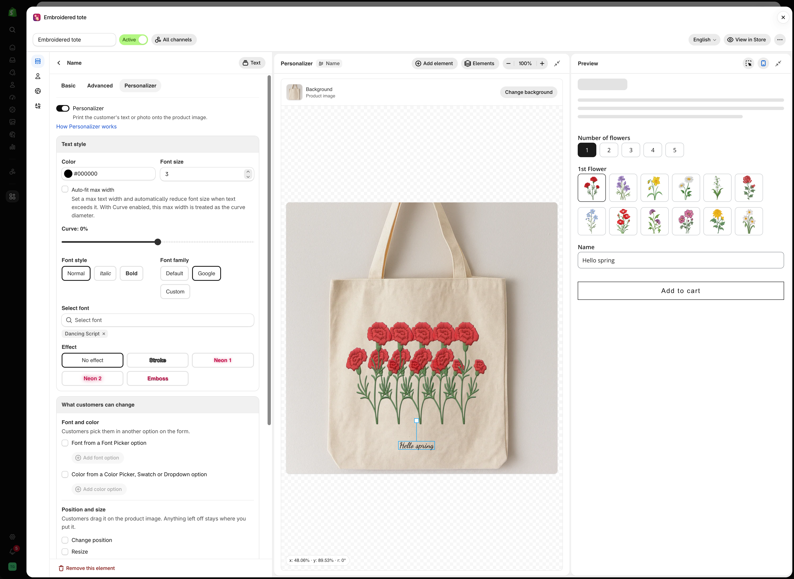

# Element settings

Once the **Personalizer** switch is on in an option's **Personalizer** tab, the cards below it control the element printed on the product image. Each card is explained on its own page.

<figure><figcaption>
A Text option's Personalizer tab starts with Text style and What customers can change. Position and size and Print area follow further down.
</figcaption></figure>

## The cards

<table data-view="cards"><thead><tr><th></th><th></th><th data-hidden data-card-target data-type="content-ref"></th></tr></thead><tbody><tr><td><strong>Text style</strong></td><td>Color, font size, alignment, and font style for text elements.</td><td><a href="text-layers.md">text-layers.md</a></td></tr><tr><td><strong>Fonts</strong></td><td>Default, Google, and your own uploaded fonts.</td><td><a href="fonts.md">fonts.md</a></td></tr><tr><td><strong>Text effects</strong></td><td>Stroke, two neon glows, and emboss.</td><td><a href="effects.md">effects.md</a></td></tr><tr><td><strong>Curve and auto-fit width</strong></td><td>Bend a line of text, and shrink it when it gets too long.</td><td><a href="curve-and-auto-fit.md">curve-and-auto-fit.md</a></td></tr><tr><td><strong>Shape and fill</strong></td><td>The shape of an image element, and how the photo fills it.</td><td><a href="image-layers.md">image-layers.md</a></td></tr><tr><td><strong>What customers can change</strong></td><td>Let customers move, resize, or rotate the element on the product image.</td><td><a href="customer-controls.md">customer-controls.md</a></td></tr><tr><td><strong>Let customers pick font and color</strong></td><td>Take the font and color of a text element from another option on the form.</td><td><a href="font-and-color.md">font-and-color.md</a></td></tr><tr><td><strong>Position and size</strong></td><td>X and Y position, width, height, rotation, and opacity.</td><td><a href="position-size-rotation.md">position-size-rotation.md</a></td></tr><tr><td><strong>Print area</strong></td><td>A crop area the element cannot leave.</td><td><a href="clip-area.md">clip-area.md</a></td></tr></tbody></table>

## Which cards an element has

<table><thead><tr><th width="230">Element</th><th width="250">Comes from</th><th>Cards</th></tr></thead><tbody><tr><td><strong>Text</strong></td><td><a href="../../option-types/input-types/text.md">Text</a>, <a href="../../option-types/input-types/textarea.md">Textarea</a>, <a href="../../option-types/input-types/number.md">Number</a></td><td><strong>Text style</strong>, <strong>What customers can change</strong>, <strong>Position and size</strong>, <strong>Print area</strong></td></tr><tr><td><strong>Image</strong></td><td><a href="../../option-types/input-types/file-upload.md">File upload</a> and eight selection types</td><td><strong>Shape and fill</strong>, <strong>What customers can change</strong>, <strong>Position and size</strong>, <strong>Print area</strong></td></tr></tbody></table>

For the settings each option type gets, see [What you get by option type](../setup.md#what-you-get-by-option-type).


Two settings stop customers from submitting a design you cannot produce:

* [Auto-fit max width](curve-and-auto-fit.md#auto-fit-max-width) shrinks long text instead of letting it run off the product.
* [Crop area](clip-area.md) keeps an element on the printable part of the product. Turn it on whenever customers can move or resize the element.


## Settings are per option

Each option keeps its own settings. A `Name` text element can use a script font across the front, while a `Date` text element is small and straight below it. Nothing on the **Personalizer** tab is store-wide.

The background is shared by every element in the option set. See [Choosing the background](../setup.md#choosing-the-background).

When the Personalizer is off, the cards stay visible but dimmed, and the option works as a normal form field.
