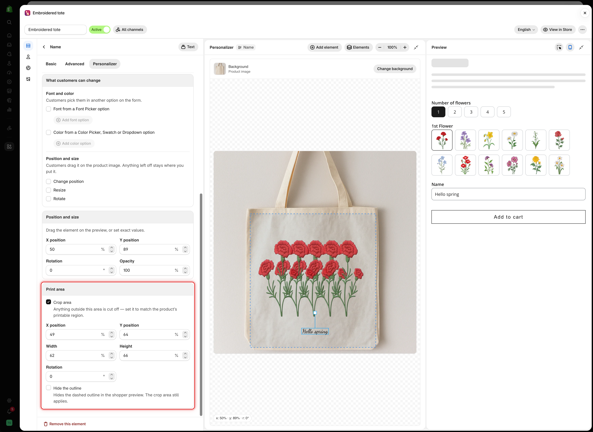

# Print area

The **Print area** card holds the **Crop area**: a rectangle on the product image. Any part of the element outside it is cut off. Use it to give customers freedom without letting them put the design where you cannot print.

It is the last card on the **Personalizer** tab of every supported option type.

<figure><figcaption>
With Crop area on, its dashed outline appears on the canvas, where you can also drag and resize it.
</figcaption></figure>

## The settings

<table><thead><tr><th width="230">Setting</th><th width="150">Default</th><th>What it does</th></tr></thead><tbody><tr><td><strong>Crop area</strong></td><td>Off</td><td>Turns the crop area on and shows the settings below</td></tr><tr><td><strong>X position</strong></td><td><code>50</code>%</td><td>Horizontal center of the area</td></tr><tr><td><strong>Y position</strong></td><td><code>50</code>%</td><td>Vertical center of the area</td></tr><tr><td><strong>Width</strong></td><td><code>50</code>%</td><td>How wide the area is</td></tr><tr><td><strong>Height</strong></td><td><code>50</code>%</td><td>How tall the area is</td></tr><tr><td><strong>Rotation</strong></td><td><code>0</code>°</td><td>Turns the area, from -180 to 180</td></tr><tr><td><strong>Hide the outline</strong></td><td>Off</td><td>Hides the dashed outline from customers. The crop area still applies</td></tr></tbody></table>

All values are percentages of the image, like [element positions](position-size-rotation.md).

## When to use it

<table><thead><tr><th width="290">Situation</th><th>Why it helps</th></tr></thead><tbody><tr><td>Customers can move an element</td><td>They cannot drag it off the printable area</td></tr><tr><td>Customers can resize an element</td><td>An oversized photo is cut at the edge instead of covering the product</td></tr><tr><td>A photo goes into a fixed window</td><td>The photo fills the window and nothing spills out</td></tr><tr><td>Text must stay on an engraved panel</td><td>Long entries are cut at the panel edge</td></tr></tbody></table>


If you turn on anything in [What customers can change](customer-controls.md), turn on **Crop area** too. Without it, customers can place the design anywhere on the image, including places you cannot print.


## How to set one up



### Turn on Crop area

In the **Print area** card. A dashed outline appears on the canvas.



### Match it to your printable area

Drag the outline on the canvas and pull its handles, or type **X position**, **Y position**, **Width**, and **Height**. Click the outline first to select it.



### Rotate it if the surface is angled

Use **Rotation**, or the handle above the selected outline.



### Place the element inside it

The element's own position is set separately in [Position and size](position-size-rotation.md). Put it where the design should start.



### Test the edge

In the **Preview**, type a long entry or drag the element toward the edge. It should be cut at the outline.



### Decide whether customers see the outline

Leave **Hide the outline** off when customers can move the element, so they can see where it fits. Turn it on when the boundary is obvious from the product itself.



## Crop area or auto-fit?

<table><thead><tr><th width="230"></th><th width="290">Crop area</th><th>Auto-fit max width</th></tr></thead><tbody><tr><td>What it does</td><td>Cuts off whatever is outside the area</td><td>Shrinks text so it fits</td></tr><tr><td>Works on</td><td>Text and image elements</td><td>Text and Number</td></tr><tr><td>Long entry</td><td>Cut off</td><td>Smaller but complete</td></tr><tr><td>Best for</td><td>A hard boundary, especially when customers can move things</td><td>Keeping the whole entry visible</td></tr></tbody></table>

For engraved text, use [auto-fit](curve-and-auto-fit.md#auto-fit-max-width) first. A smaller complete name is better than a cut-off one. Add a crop area when customers can move the element or your print area is tight.

## Notes

* Each element has its own crop area.
* The crop area stays put while the element moves inside it.
* The crop area only shapes the design image. Match it to your real print area.
* Rotating the crop area and rotating the element are separate settings.
