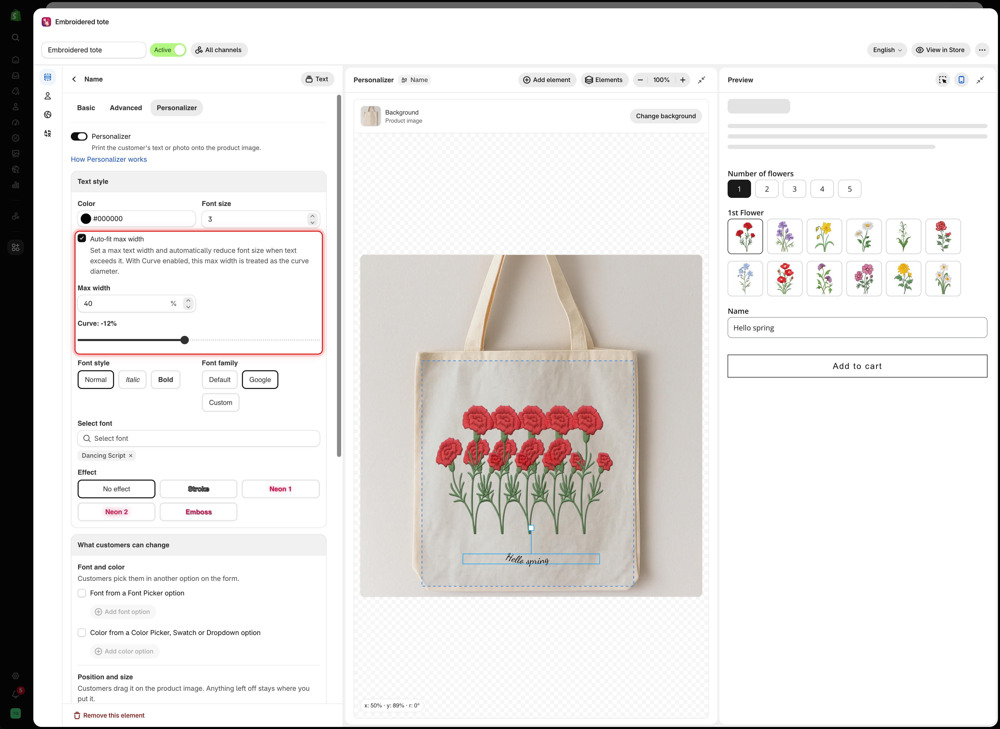

# Curve and auto-fit width

Two settings in the **Text style** card of Text and Number options. They handle round surfaces and text that grows longer than the space you have. Textarea uses **Width** and **Height** instead. See [Position and size](position-size-rotation.md).

<figure><figcaption>
Auto-fit max width and Curve sit together in Text style, above Font style.
</figcaption></figure>

## Curve

Bends the line of text along an arc.

<table><thead><tr><th width="180">Range</th><th width="150">Default</th><th>Behavior</th></tr></thead><tbody><tr><td>-100% to 100%</td><td><code>0%</code></td><td><code>0%</code> is a straight line. Positive values bend one way, negative values the other</td></tr></tbody></table>

Use it for text on a round surface, such as a mug, a plate rim, a ring band, or a badge. Straight text on these products looks pasted on.

<table><thead><tr><th width="230">Try</th><th>For</th></tr></thead><tbody><tr><td><code>10%</code> to <code>30%</code></td><td>A gentle bend, such as a plate rim</td></tr><tr><td>A higher value</td><td>A tighter curve, such as a ring band</td></tr><tr><td>A negative value</td><td>Text below the center of a circle instead of above it</td></tr></tbody></table>

The right value depends on the curve in your own photo, so set it by eye on the canvas.

## Auto-fit max width

Reduces the font size automatically when the text gets wider than a limit you set.

<table><thead><tr><th width="230">Setting</th><th width="150">Default</th><th>What it does</th></tr></thead><tbody><tr><td><strong>Auto-fit max width</strong></td><td>Off</td><td>Turns auto-fit on and shows <strong>Max width</strong></td></tr><tr><td><strong>Max width</strong></td><td><code>50</code>%</td><td>The widest the text may get, as a share of the image width</td></tr></tbody></table>

Without it, text grows as the customer types. A short name fits, a long one runs off the product. With it, long entries shrink and stay inside the width.



### Turn on Auto-fit max width

In the text element's **Text style** card.



### Set Max width to the printable width

If the print area covers about a third of the photo's width, start with `33`.



### Test with the longest entry

Type the longest text your **Max character** limit allows in the **Preview**. It should shrink and stay inside the width.



### Check it is still readable

If the longest entry becomes too small to read, lower **Max character**.




Turn this on for any engraving or embroidery field. You cannot predict how long customers' text will be.


## Using both together

With **Curve** on, **Max width** is used as the diameter of the curve. On a round product, use both: **Max width** sets the size of the arc and **Curve** sets how far the text bends.

<table><thead><tr><th width="290">Product</th><th>Setup</th></tr></thead><tbody><tr><td>A mug with text around the side</td><td>Curve to match the mug, auto-fit on with the printable band as the max width</td></tr><tr><td>A ring band</td><td>A stronger curve, a small max width, and a tight <strong>Max character</strong> limit</td></tr><tr><td>A flat engraved plate</td><td>Curve at <code>0%</code>, auto-fit on</td></tr><tr><td>A jersey number</td><td>Curve at <code>0%</code>, auto-fit off. One or two digits cannot overflow</td></tr></tbody></table>

## Pair them with a character limit

These settings make long entries fit. They do not limit length. A 40-character entry on a 12-character plate shrinks to a size you cannot produce.

Set a [Max character](../../option-types/shared-settings/limits.md#min-and-max-character) limit that matches what you can produce, and turn on the [Character counter](../../option-types/shared-settings/limits.md#character-counter) so customers see the limit.

## Notes

* Both settings are available on Text and Number only.
* Auto-fit only shrinks text. It never enlarges short text.
* Neither setting changes your production. They only make the design match it.
