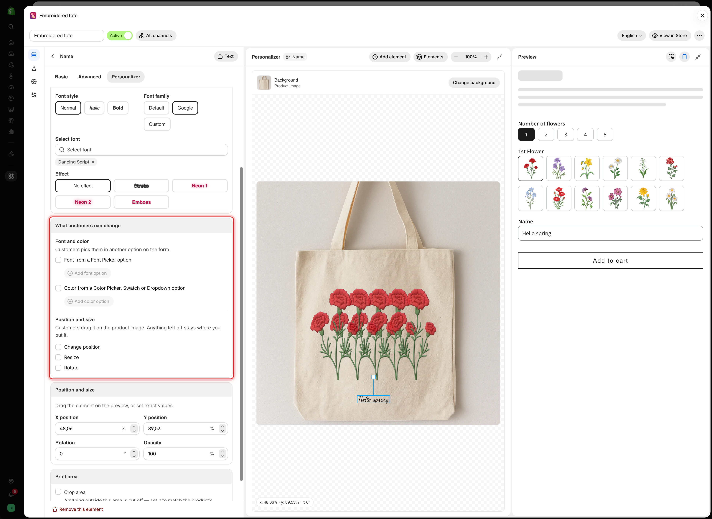
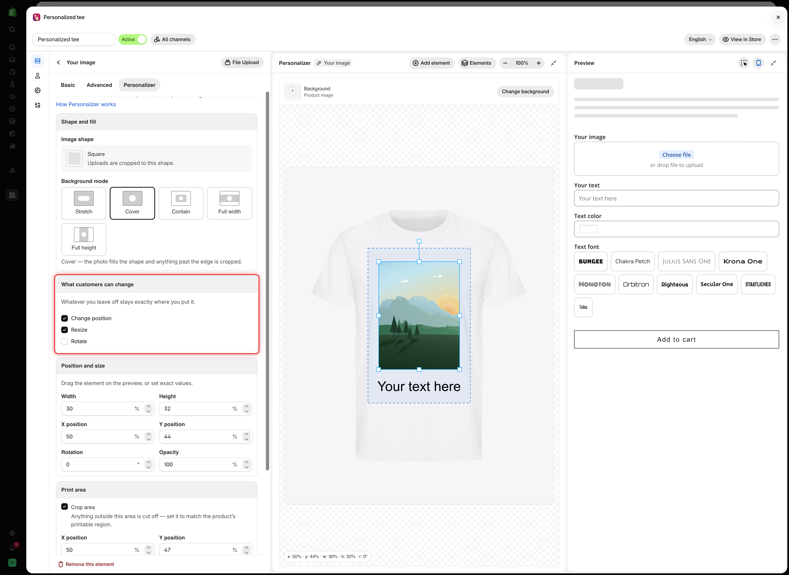
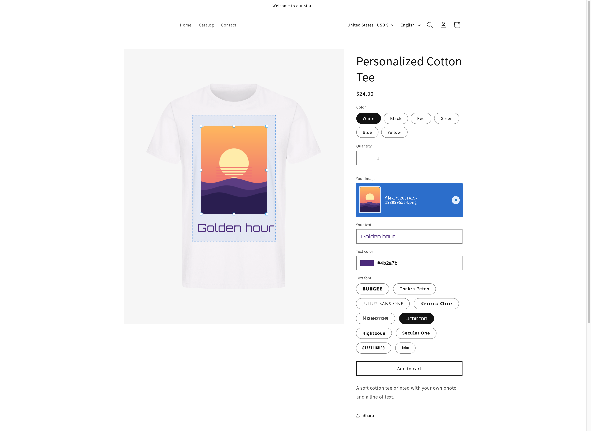

# What customers can change

The **What customers can change** card decides what customers may adjust themselves on the product image. Its help text sums up the rule: **Whatever you leave off stays exactly where you put it.**

All options are off by default, so customers only change the content: the text they type or the photo they upload.

## On a text element

The card has two parts.

<table><thead><tr><th width="230">Part</th><th>What it controls</th></tr></thead><tbody><tr><td><strong>Font and color</strong></td><td>Lets customers pick the font and color in another option on the form. See <a href="font-and-color.md">Let customers pick font and color</a></td></tr><tr><td><strong>Position and size</strong></td><td><strong>Change position</strong>, <strong>Resize</strong>, and <strong>Rotate</strong> on the product image</td></tr></tbody></table>

<figure><figcaption>
On a text element, the card covers both the font and color source and what customers can move.
</figcaption></figure>

## On an image element

The card has the three checkboxes only.

<figure><figcaption>
For a photo upload, Change position and Resize let customers frame their own photo.
</figcaption></figure>

## The three permissions

<table><thead><tr><th width="230">Permission</th><th>What the customer can do</th></tr></thead><tbody><tr><td><strong>Change position</strong></td><td>Drag the element on the product image</td></tr><tr><td><strong>Resize</strong></td><td>Drag the handles to make it bigger or smaller. Text has corner handles only, so it keeps its shape</td></tr><tr><td><strong>Rotate</strong></td><td>Drag the handle above it to turn it</td></tr></tbody></table>


If you turn on any of these, also turn on **Crop area** in the [Print area](clip-area.md) card. Without it, a customer can drag a photo onto the handle of a mug or stretch text across the whole product, and the order is placed with that design.

Leave **Hide the outline** off so customers can see the area they can work in.


## What the customer sees

On the product page, the customer clicks or taps the element to select it. Handles appear for what you allowed, and they can drag the element itself if **Change position** is on. On phones and tablets the handles are larger, so they are easier to grab.

<figure><figcaption>
On the storefront, selecting the photo shows handles for resizing, and the dashed outline shows where it can go.
</figcaption></figure>

Your **Position and size** values are the starting point. The customer's final arrangement is what goes into the design saved with the order. See [Designs in cart and orders](../cart-and-orders.md).

## When to turn them on

<table><thead><tr><th width="290">Situation</th><th width="200">Turn on</th><th>Why</th></tr></thead><tbody><tr><td>A customer photo in a frame or print area</td><td><strong>Change position</strong>, <strong>Resize</strong></td><td>Only they know which part of the photo matters</td></tr><tr><td>A logo on a garment</td><td><strong>Change position</strong>, <strong>Resize</strong></td><td>Placement is part of what they are buying</td></tr><tr><td>An engraved name on a plate</td><td>Nothing</td><td>You know where the plate is</td></tr><tr><td>A design chosen from your own list</td><td>Nothing</td><td>You placed it already</td></tr><tr><td>A free-form sticker or collage layout</td><td>All three</td><td>The arrangement is the product</td></tr><tr><td>Text on a curved surface</td><td>Nothing</td><td><a href="curve-and-auto-fit.md#curve">Curve</a> handles it better</td></tr></tbody></table>

Turn them on when placement is the customer's decision. Leave them off when placement is a production limit.

**Rotate** causes the most trouble. A slightly turned photo in a frame looks like a mistake, and turned engraving is often impossible to produce. Use it only where an angled result is a real product.

## Notes

* Permissions are per element, so one element can move while another stays fixed.
* Small elements are hard to drag on a phone. Set a starting position that most customers will keep.
* Say in the option's help text what happens to anything outside the print area, for example "Anything outside the dashed line is not printed."
