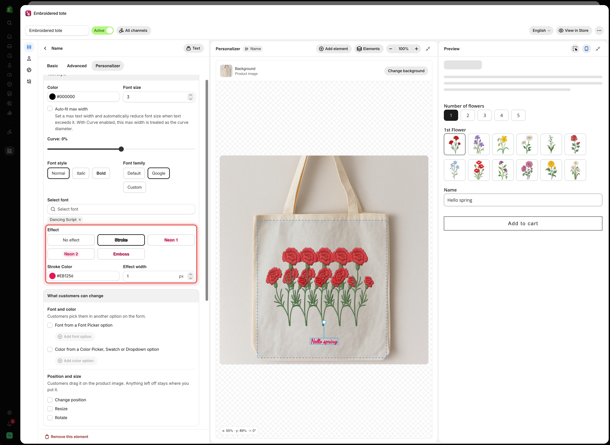

# Text effects

**Effect**, at the bottom of the **Text style** card, adds a visual treatment to a text element. Pick the effect that looks most like the product you make.

## The effects

Each button previews its effect, so you can choose by eye.

<table><thead><tr><th width="200">Effect</th><th width="290">Looks like</th><th>Shows</th></tr></thead><tbody><tr><td><strong>No effect</strong> (default)</td><td>Plain text</td><td>Nothing</td></tr><tr><td><strong>Stroke</strong></td><td>An outline around each letter</td><td><strong>Stroke Color</strong>, <strong>Effect width</strong></td></tr><tr><td><strong>Neon 1</strong></td><td>A soft glow</td><td>Nothing</td></tr><tr><td><strong>Neon 2</strong></td><td>A stronger glow with a bright edge</td><td>Nothing</td></tr><tr><td><strong>Emboss</strong></td><td>Raised or pressed letters, made with a shadow</td><td><strong>Shadow X-Axis</strong>, <strong>Shadow Y-Axis</strong></td></tr></tbody></table>

<figure><figcaption>
Selecting Stroke shows its color and width settings right below the effect buttons.
</figcaption></figure>

## Stroke

<table><thead><tr><th width="230">Setting</th><th width="170">Default</th><th>What it does</th></tr></thead><tbody><tr><td><strong>Stroke Color</strong></td><td><code>#EB1256</code></td><td>The outline color</td></tr><tr><td><strong>Effect width</strong></td><td><code>1</code> px</td><td>The outline thickness</td></tr></tbody></table>

A stroke keeps text readable over photos. Light text with a thin dark stroke stays legible on any uploaded photo, light or dark. If you print text over customer photos, use a stroke.

Keep **Effect width** low. Above about `2`, the outline starts to cover the letters.

## Neon 1 and Neon 2

Two glow effects with no extra settings. Use them for products that light up, such as LED signs and acrylic light panels. Compare both on your own product image and keep the one that looks right.

## Emboss

<table><thead><tr><th width="230">Setting</th><th width="170">Default</th><th>What it does</th></tr></thead><tbody><tr><td><strong>Shadow X-Axis</strong></td><td><code>1</code> px</td><td>Moves the shadow left or right, from -100 to 100</td></tr><tr><td><strong>Shadow Y-Axis</strong></td><td><code>1</code> px</td><td>Moves the shadow up or down, from -100 to 100</td></tr></tbody></table>

Small offsets look physical. Large offsets look like a drop shadow.

<table><thead><tr><th width="290">Look</th><th>Try</th></tr></thead><tbody><tr><td>Pressed into the surface</td><td>Small positive values, around <code>1</code> to <code>2</code></td></tr><tr><td>Raised off the surface</td><td>Small negative values</td></tr><tr><td>Matching your photo</td><td>Point the shadow the same way as the shadows already in the image</td></tr></tbody></table>

## Choosing an effect

<table><thead><tr><th width="290">Product</th><th>Effect</th></tr></thead><tbody><tr><td>Engraved metal or wood</td><td><strong>Emboss</strong> with small offsets, or <strong>No effect</strong></td></tr><tr><td>Printed text on fabric or paper</td><td><strong>No effect</strong></td></tr><tr><td>Text over a customer's photo</td><td><strong>Stroke</strong>, thin, in a contrasting color</td></tr><tr><td>LED or acrylic light products</td><td><strong>Neon 1</strong> or <strong>Neon 2</strong></td></tr><tr><td>Embroidery</td><td><strong>No effect</strong>, with a font that suits stitching</td></tr></tbody></table>


Choose the effect closest to what the customer will receive. A glowing preview on a flat engraved product is misleading, even when the order itself is correct.


## Notes

* One effect per element, applied to the whole text.
* The effect is drawn on top of the [Color](text-layers.md#color), so check both together.
* Effects change the design image only, not your production.
* Thick strokes and large shadows on long text draw more slowly on older phones.
