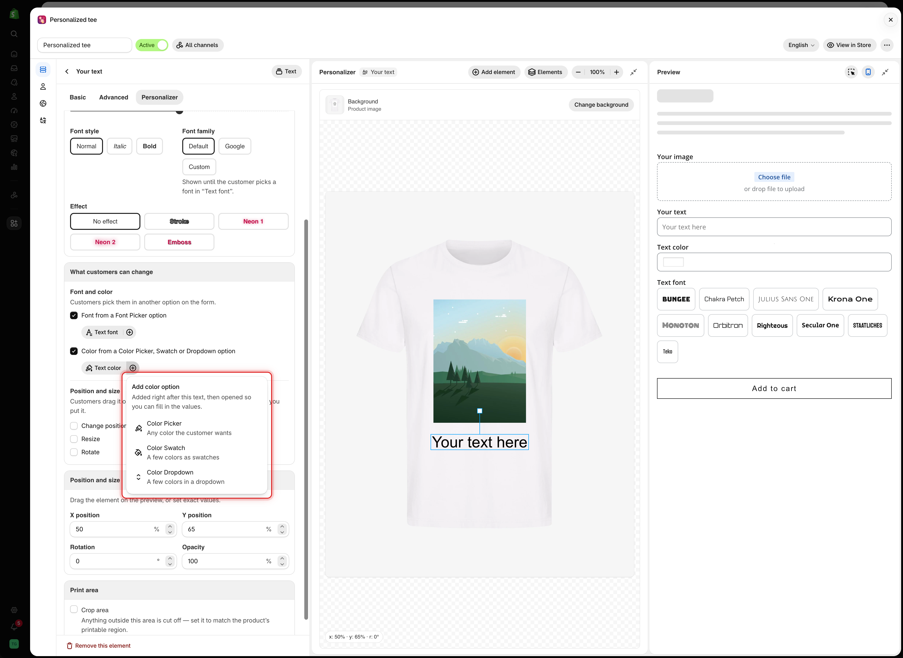
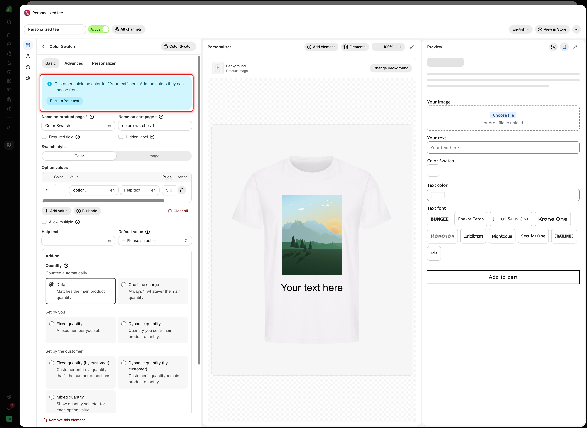
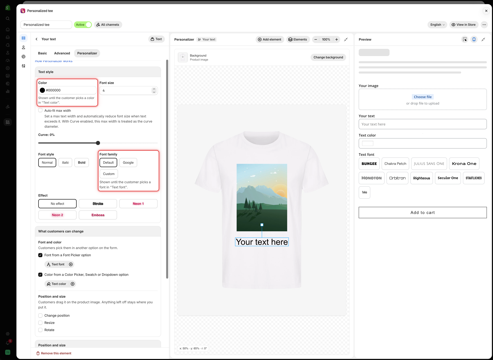

# Let customers pick font and color

A text element normally prints in the font and color you set in **Text style**. To let customers choose, link it to other options on the form: a [Font picker](../../option-types/selection-types/font-picker.md) for the font, and a [Color picker](../../option-types/input-types/color-picker.md), [Color swatch](../../option-types/selection-types/color-swatch.md), or [Color dropdown](../../option-types/selection-types/color-dropdown.md) for the color.

You set the link on the text option, in the **Font and color** part of the **What customers can change** card. The card says what it does: **Customers pick them in another option on the form.**

<figure><figcaption>
Once linked, each checkbox shows the name of the option customers use to pick the font or the color.
</figcaption></figure>

## Before you start

* A Text, Textarea, or Number option with the Personalizer turned on. See [Set up the Personalizer](../setup.md).
* Optional: the Font picker and color option already on the form. If they are not, you can add them from the card.

## Steps



### Open the text option's Personalizer tab

Select the text option and go to **Personalizer** > **What customers can change** > **Font and color**.



### Tick Font from a Font Picker option

What happens next depends on your form:

<table><thead><tr><th width="290">Your form has</th><th>What happens</th></tr></thead><tbody><tr><td>One Font picker</td><td>It is linked straight away, and its name appears under the checkbox</td></tr><tr><td>Two or more Font pickers</td><td>A list opens. Pick the one customers should use</td></tr><tr><td>No Font picker</td><td>Select <strong>Add font option</strong>. A Font picker is added right after the text option and opened for you</td></tr></tbody></table>

To change the linked Font picker later, select its name and pick another one.



### Tick Color from a Color Picker, Swatch or Dropdown option

It works the same way. To add a new color option, select **Add color option** and choose the kind of option.

<table><thead><tr><th width="230">Option</th><th>Card description</th></tr></thead><tbody><tr><td><strong>Color Picker</strong></td><td>Any color the customer wants</td></tr><tr><td><strong>Color Swatch</strong></td><td>A few colors as swatches</td></tr><tr><td><strong>Color Dropdown</strong></td><td>A few colors in a dropdown</td></tr></tbody></table>

<figure><figcaption>
Add color option inserts the new option right after the text option and opens it.
</figcaption></figure>



### Fill in the new option

If you added a new option, it opens on its **Basic** tab with a banner such as **Customers pick the color for “Your text” here. Add the colors they can choose from.** Add the fonts or colors customers can choose.

Select **Back to Your text** in the banner to return to the text option.

<figure><figcaption>
The banner reminds you which text the new option controls and takes you back to it.
</figcaption></figure>



### Check the fallback notes

Back on the text option, **Text style** now shows a note under **Color** and **Font family**, explaining when your own settings are used.

<figure><figcaption>
After linking, your own Color and Font family become the starting look, used until the customer picks.
</figcaption></figure>

<table><thead><tr><th width="290">Note</th><th>Meaning</th></tr></thead><tbody><tr><td><strong>Shown until the customer picks a font in “Text font”.</strong></td><td>Your <strong>Font family</strong> is used until the customer picks a font</td></tr><tr><td><strong>Shown until the customer picks a color in “Text color”.</strong></td><td>Your <strong>Color</strong> is used until the customer picks a color</td></tr><tr><td><strong>Not used: “Text font” starts on Bungee.</strong></td><td>The Font picker has a default value, so customers start on that font and your <strong>Font family</strong> is never shown</td></tr></tbody></table>



### Test it in the preview

In the **Preview**, type some text, then pick a few fonts and colors. The text on the product image changes with each choice. See [Test like a customer](../test-like-a-customer.md).



## What customers see

Customers pick a font and a color in the form, and the text on the product image changes straight away. The Font picker and color option also show the customer's own words in the chosen font and color, because linking turns on **Font preview** or **Color preview** on those options.

## How the link works

* A text element has one font source and one color source. Linking it to a new source removes it from the old one.
* One Font picker or color option can control several text elements. Link each text option to it.
* The link is the same setting as **Font preview** or **Color preview** with **Select text box** on the source option. Change it in either place and the other updates.
* Untick the checkbox to remove the link. The text goes back to your own font or color.
* If a linked option is hidden by [conditional logic](../../conditional-logic/conditional-logic.md), the text uses your own **Font family** and **Color** on the storefront.


If a checkbox is ticked but no option is chosen, **Save** takes you to the problem instead of saving. The card shows **Pick a Font Picker, or untick Font.** or **Pick a color option, or untick Color.** If the form has no matching option yet, it shows **No font option on this form yet.** or **No color option on this form yet.** Choose or add an option, or untick the box.


## Notes

* Only list fonts and colors you can produce. Every font in a Font picker is loaded for the preview, so keep the list short.
* The customer's font and color are saved on the order with the rest of their choices.
* Give the Font picker and color option clear names on the cart page, such as `Text font` and `Text color`, so your team can read the order.
