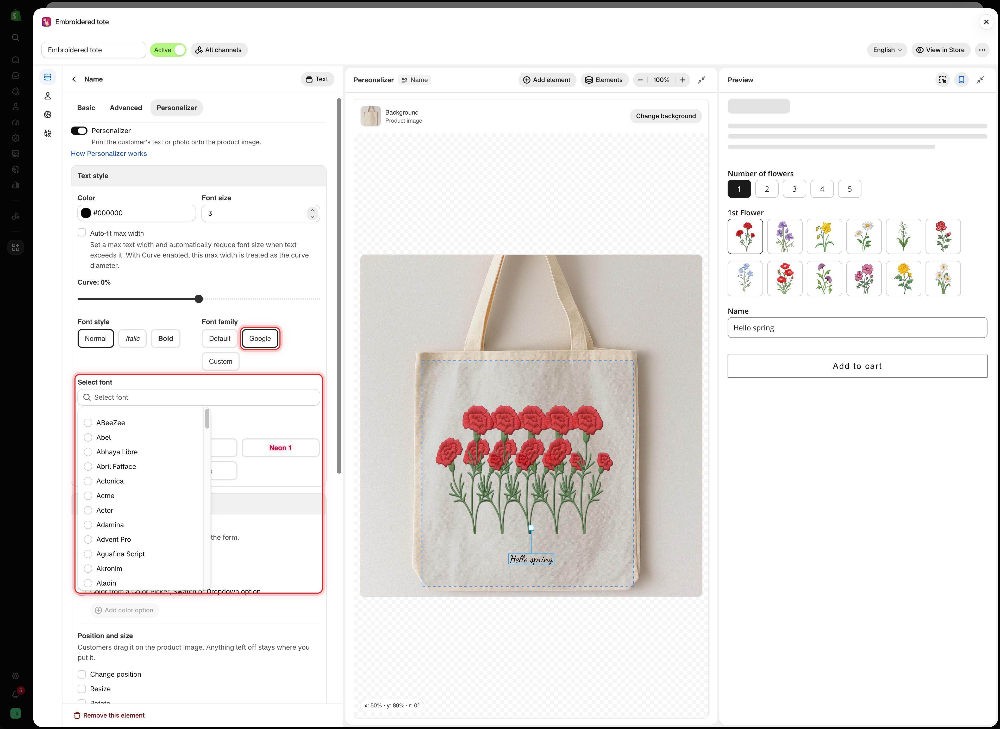

# Fonts

**Font family**, in the **Text style** card, sets the typeface a text element is printed in. Use the font you produce with, so the design matches the finished product.

**Watch it done (2:13).** The Personalizer version of font and color preview: the live preview is set up first, then the font and color options go on top, so the customer picks a typeface and a shade and watches the product image change.



If you only want the font and color shown inside the form, with nothing printed on the product image, the 1:28 video on [Swatch style and previews](../../option-types/shared-settings/swatch-style-and-previews.md) covers that on its own.

## The three choices

<table><thead><tr><th width="200">Font family</th><th width="290">What it uses</th><th>Shows</th></tr></thead><tbody><tr><td><strong>Default</strong></td><td>The app's standard typeface</td><td>Nothing more</td></tr><tr><td><strong>Google</strong></td><td>A font from the Google Fonts library</td><td><strong>Select font</strong>, a searchable list</td></tr><tr><td><strong>Custom</strong></td><td>A font file you uploaded to the app</td><td><strong>Select font</strong>, a list of your uploaded fonts</td></tr></tbody></table>

<figure><figcaption>
Choosing Google or Custom shows Select font, where you pick the font itself.
</figcaption></figure>

## Default

The app's own typeface. Use it while you build, or when the font is not part of the product. It is not a good match for engraving or embroidery, because it will not look like the font you produce.

## Google

Search for a font in **Select font** and select it. The text on the canvas changes straight away.

<table><thead><tr><th width="290">Good for</th><th>Check</th></tr></thead><tbody><tr><td>Finding a close match to your production font quickly</td><td>Close is not the same. Compare the letters your customers will actually use</td></tr><tr><td>Script and display faces you do not own</td><td>Very ornate faces are hard to read at small sizes</td></tr><tr><td>Matching a Google font your storefront already uses</td><td>Accents and non-Latin characters, if your customers use them</td></tr></tbody></table>

## Custom

Your own font file, uploaded to the app once and then available in **Select font**. Use it when the font is part of the product, for example the exact typeface your engraving machine uses.



### Upload the font

Go to **Settings** > **Settings** > **General** > **Custom fonts**. See [Custom fonts](../../settings/custom-fonts.md).



### Set Font family to Custom

On the text element's **Personalizer** tab, in **Text style**.



### Select the font

Pick it from **Select font**.



### Test the characters you need

Type accented letters, punctuation, and digits in the **Preview**. Some display fonts do not include them.



Custom fonts may not be available on all plans. See [Compare plans](../../plans-and-billing/compare-plans.md).

## Letting customers choose the font

The **Font family** you set here is fixed. To let customers choose, add a [Font picker](../../option-types/selection-types/font-picker.md) option and link the text element to it from the **What customers can change** card. The customer's choice then replaces your font on the product image. See [Let customers pick font and color](font-and-color.md).

## Choosing fonts you can produce

<table><thead><tr><th width="290">Ask</th><th>Because</th></tr></thead><tbody><tr><td>Can our machine or supplier use this font?</td><td>Otherwise every order needs a conversation</td></tr><tr><td>Does it include every character customers type?</td><td>Accents, apostrophes, and digits are often missing</td></tr><tr><td>Is it readable at the size we print?</td><td>Fine strokes disappear when engraved small</td></tr><tr><td>Are we licensed to use it commercially?</td><td>Font licenses cover production as well as your website</td></tr></tbody></table>

## Notes

* One font per element. For two fonts on one product, use two text options.
* [Font style](text-layers.md#font-style) (bold and italic) is a separate setting and needs the font to include those versions.
* Google fonts load from Google. Custom fonts load from the app.
* Every font in a Font picker list is loaded for the preview, so a long list takes longer to show.
