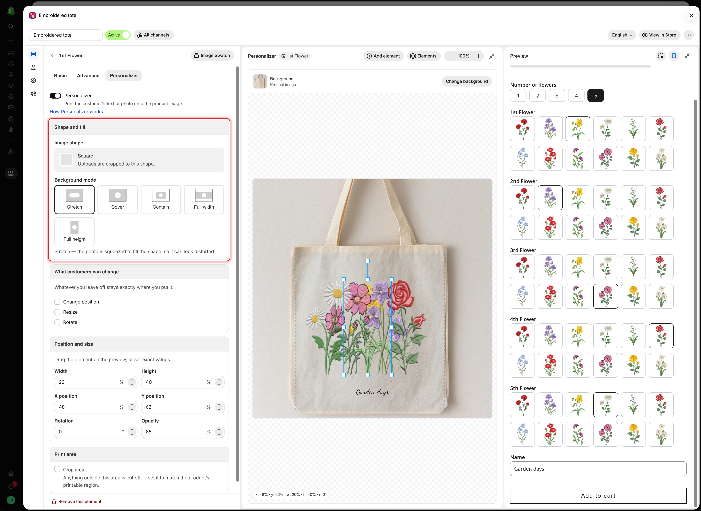

# Shape and fill

An image element prints a picture on the product image: the file the customer uploaded, or the image attached to the value they selected. The **Shape and fill** card is the first card on its **Personalizer** tab.

**Applies to:** [File upload](../../option-types/input-types/file-upload.md), and eight selection types: [Dropdown](../../option-types/selection-types/dropdown.md), [Color dropdown](../../option-types/selection-types/color-dropdown.md), [Image dropdown](../../option-types/selection-types/image-dropdown.md), [Radio button](../../option-types/selection-types/radio-button.md), [Checkbox](../../option-types/selection-types/checkbox.md), [Button](../../option-types/selection-types/button.md), [Color swatch](../../option-types/selection-types/color-swatch.md), [Image swatch](../../option-types/selection-types/image-swatch.md).

<figure><figcaption>
Image shape sets the outline of the element, and Background mode sets how the picture fills it.
</figcaption></figure>

## Where the image comes from

<table><thead><tr><th width="290">Option type</th><th>The element prints</th></tr></thead><tbody><tr><td>File upload</td><td>The file the customer uploaded</td></tr><tr><td>The eight selection types</td><td>The image on the option value they selected</td></tr></tbody></table>

For selection types, give each value its own image in the values table. See [Working with option values](../../option-sets/option-values.md).

## Image shape

The image is cut to a shape, as the card says: **Uploads are cropped to this shape.** Select **Change** to open **Select shape image**.

* Choose a preset: **Square**, **Circle**, **Triangle**, **Diamond**, **Pentagon**, **Hexagon**, **Gem**, **Heart**, **Semicircle**, **Star**, **Crescent**, or **Cross**.
* Or upload your own shape image for an unusual window, such as a locket or a phone case camera cut-out.

Match the shape's proportions to the real window on your product. A square shape on a portrait frame crops the customer's photo unexpectedly. Set the proportions with **Width** and **Height** in [Position and size](position-size-rotation.md).

## Background mode

How the picture fills the shape. The card describes the selected mode below the buttons.

<table><thead><tr><th width="200">Mode</th><th>What happens</th></tr></thead><tbody><tr><td><strong>Stretch</strong></td><td>The photo is squeezed to fill the shape, so it can look distorted</td></tr><tr><td><strong>Cover</strong> (default)</td><td>The photo fills the shape and anything past the edge is cropped</td></tr><tr><td><strong>Contain</strong></td><td>The whole photo fits inside the shape, so some of the shape stays empty</td></tr><tr><td><strong>Full width</strong></td><td>The photo spans the full width. Top and bottom may be cropped</td></tr><tr><td><strong>Full height</strong></td><td>The photo spans the full height. Left and right may be cropped</td></tr></tbody></table>


Do not use **Stretch** for customer uploads. A portrait photo in a landscape shape looks squashed. Use **Cover**, and turn on the File upload option's [image editor](../../option-types/input-types/file-upload.md) so customers can crop their photo before it is printed.


## Example

A t-shirt where the customer uploads a photo for the front print:

<table><thead><tr><th width="290">Setting</th><th>Value</th></tr></thead><tbody><tr><td>Option</td><td>File upload, required, <strong>Allowed extensions</strong> <code>jpg</code>, <code>jpeg</code>, <code>png</code></td></tr><tr><td>Help text</td><td><code>JPG or PNG, at least 1500 × 1500 pixels</code></td></tr><tr><td><strong>Image shape</strong></td><td><strong>Square</strong></td></tr><tr><td><strong>Background mode</strong></td><td><strong>Cover</strong></td></tr><tr><td><strong>Width</strong> and <strong>Height</strong></td><td>The size of the print, for example 30 and 32</td></tr><tr><td><strong>Crop area</strong></td><td>On, matching the printable area on the chest</td></tr><tr><td><strong>What customers can change</strong></td><td><strong>Change position</strong> and <strong>Resize</strong></td></tr></tbody></table>

## Letting customers pick a design instead



### Add a selection option with an image on each value

An [Image swatch](../../option-types/selection-types/image-swatch.md) shows a grid. An [Image dropdown](../../option-types/selection-types/image-dropdown.md) suits a long list. Use the same proportions for every value image.



### Turn on the Personalizer

On the option's **Personalizer** tab, or with **Add element** in the editor.



### Set the shape and place it

Choose **Image shape** and **Background mode**, then drag the element to where the design goes.



### Leave customer controls off

You placed the design already, so customers only need to choose it.



An option that allows several selections prints one image per selected value, and they can overlap. Limit it to one selection, or place the values so they do not overlap.

## Notes

* An image element shows nothing until a file is uploaded or a value with an image is selected. It has no default value.
* Small uploads look blurry when enlarged. State a minimum size in the help text.
* An uploaded shape image can be reused on other options.
