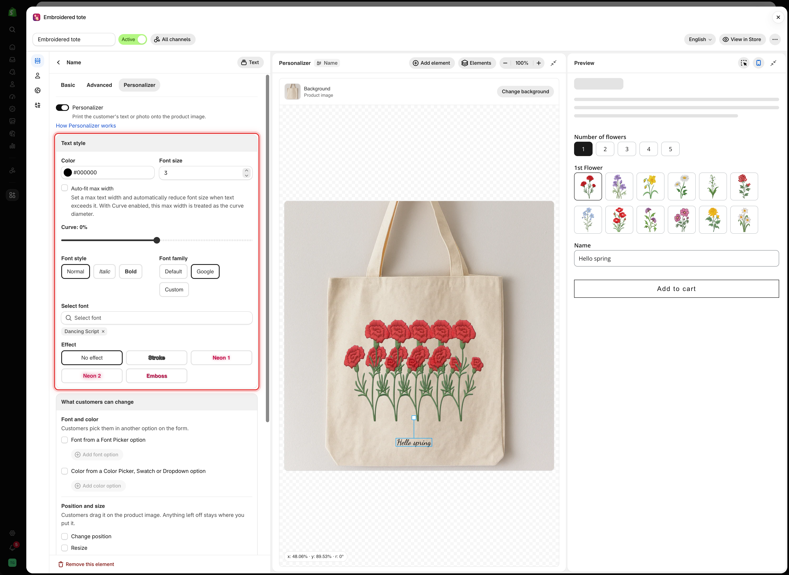

# Text style

The **Text style** card controls how a text element looks on the product image. It is the first card on the **Personalizer** tab of a Text, Textarea, or Number option.

<figure><figcaption>
Text style holds everything about how the text itself looks.
</figcaption></figure>

## The settings

<table><thead><tr><th width="230">Setting</th><th width="170">Default</th><th>What it does</th></tr></thead><tbody><tr><td><strong>Color</strong></td><td><code>#000000</code></td><td>The color the text is printed in</td></tr><tr><td><strong>Font size</strong></td><td><code>6</code></td><td>The text size, from 0 to 50, relative to the image</td></tr><tr><td><strong>Auto-fit max width</strong></td><td>Off</td><td>Shrinks long text to fit a width. Text and Number only. See <a href="curve-and-auto-fit.md#auto-fit-max-width">Auto-fit max width</a></td></tr><tr><td><strong>Curve</strong></td><td><code>0%</code></td><td>Bends the line of text. Text and Number only. See <a href="curve-and-auto-fit.md#curve">Curve</a></td></tr><tr><td><strong>Text alignment</strong></td><td><strong>Center</strong></td><td><strong>Left</strong>, <strong>Center</strong>, or <strong>Right</strong>. Textarea only</td></tr><tr><td><strong>Font style</strong></td><td><strong>Normal</strong></td><td><strong>Normal</strong>, <strong>Italic</strong>, or <strong>Bold</strong></td></tr><tr><td><strong>Font family</strong></td><td><strong>Default</strong></td><td><strong>Default</strong>, <strong>Google</strong>, or <strong>Custom</strong>. See <a href="fonts.md">Fonts</a></td></tr><tr><td><strong>Effect</strong></td><td><strong>No effect</strong></td><td><strong>Stroke</strong>, <strong>Neon 1</strong>, <strong>Neon 2</strong>, or <strong>Emboss</strong>. See <a href="effects.md">Text effects</a></td></tr></tbody></table>

## Color

Pick a color you can actually produce. If you engrave in silver, a light gray preview is closer to the result than black.

Check the color against the product image, not the settings panel. Dark text on a dark product is hard to read.

To let customers choose the color, link the text to a Color picker, Color swatch, or Color dropdown option. Your **Color** is then shown only until the customer picks one. See [Let customers pick font and color](font-and-color.md).

## Font size

The scale runs from 0 to 50 and is relative to the background image, not measured in points. The text keeps its proportion on a phone and on a large screen.

<table><thead><tr><th width="230">Roughly</th><th>Suits</th></tr></thead><tbody><tr><td><code>3</code> to <code>5</code></td><td>Small engraving, such as a monogram or the inside of a ring</td></tr><tr><td><code>6</code> to <code>10</code></td><td>A typical engraved or printed name</td></tr><tr><td><code>12</code> to <code>20</code></td><td>A bold statement, such as a jersey number</td></tr><tr><td><code>25</code> and up</td><td>Text as the main design</td></tr></tbody></table>

Set the size against your own product image, then test it with the longest entry your **Max character** limit allows.

## Text alignment

Available on Textarea only, because it is the only text type with several lines. Alignment works inside the element's **Width**, set in [Position and size](position-size-rotation.md).

<table><thead><tr><th width="200">Alignment</th><th>Use for</th></tr></thead><tbody><tr><td><strong>Left</strong></td><td>Addresses, lists, anything read as a block</td></tr><tr><td><strong>Center</strong></td><td>Messages and greetings. The default</td></tr><tr><td><strong>Right</strong></td><td>A signature or a deliberately one-sided design</td></tr></tbody></table>

## Font style

**Normal**, **Italic**, or **Bold** applies to the whole element. You cannot style part of the text.

If a font has no real italic or bold version, the text may look slanted or thickened artificially. Test the result.

## Example

An engraved bracelet:

<table><thead><tr><th width="290">Setting</th><th>Value</th></tr></thead><tbody><tr><td>Option</td><td>Text, <strong>Max character</strong> 15, <strong>Default value</strong> <code>Your name</code></td></tr><tr><td><strong>Color</strong></td><td>A light gray, like engraved silver</td></tr><tr><td><strong>Font size</strong></td><td><code>5</code></td></tr><tr><td><strong>Auto-fit max width</strong></td><td>On, so long names shrink instead of running off the plate</td></tr><tr><td><strong>Font family</strong></td><td><strong>Google</strong>, a clean script</td></tr><tr><td><strong>Effect</strong></td><td><strong>Emboss</strong> with small offsets</td></tr></tbody></table>

## Notes

* Set a **Default value** on the **Basic** tab so the design is never empty.
* [Text transform](../../option-types/shared-settings/text-input-rules.md#text-transform) is applied before the text is printed, so the element shows the transformed text.
* A **Max character** limit also limits how far the text can run.
* Number elements work like Text elements. Use them for jersey numbers and years.
