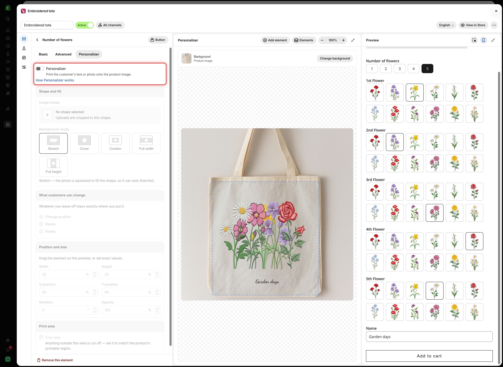
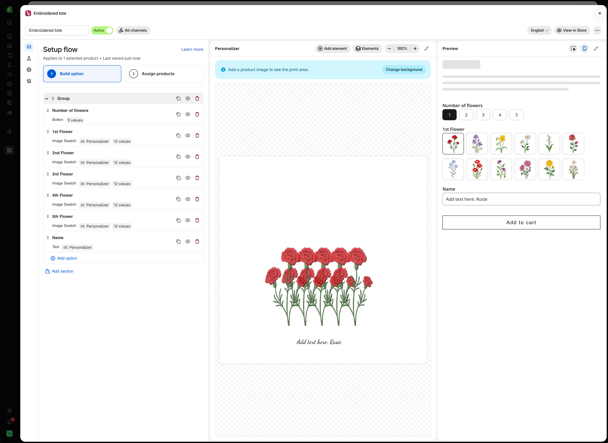
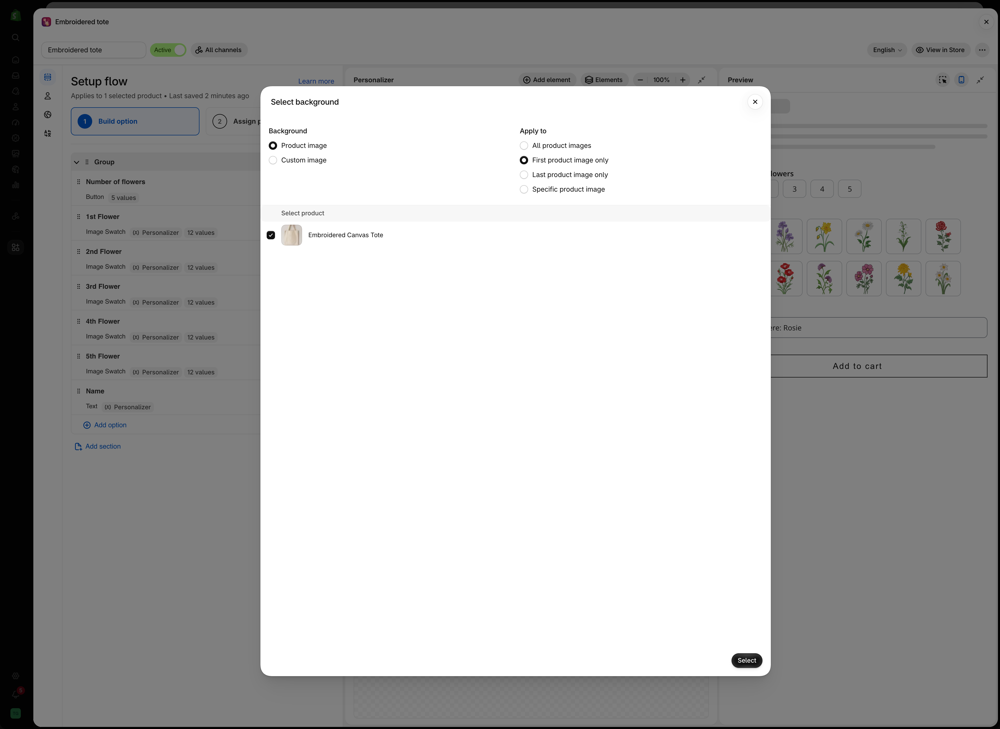
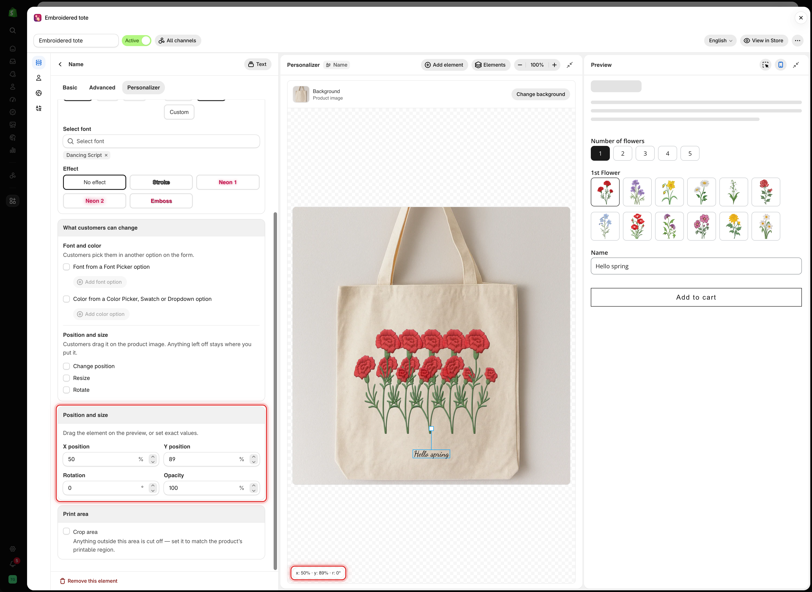
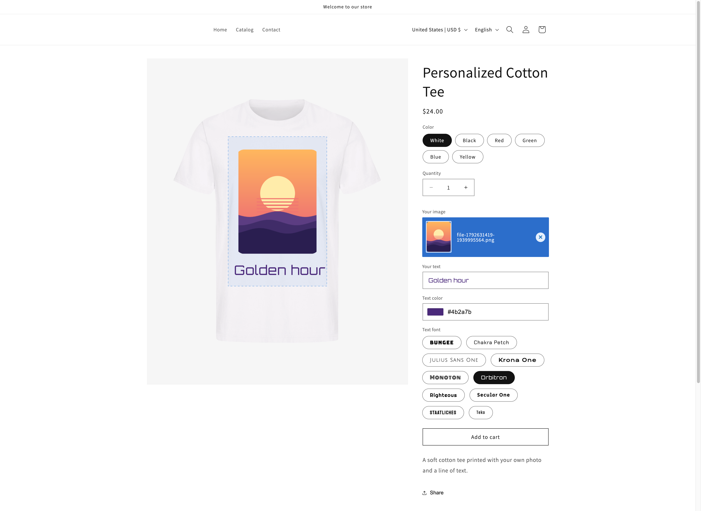
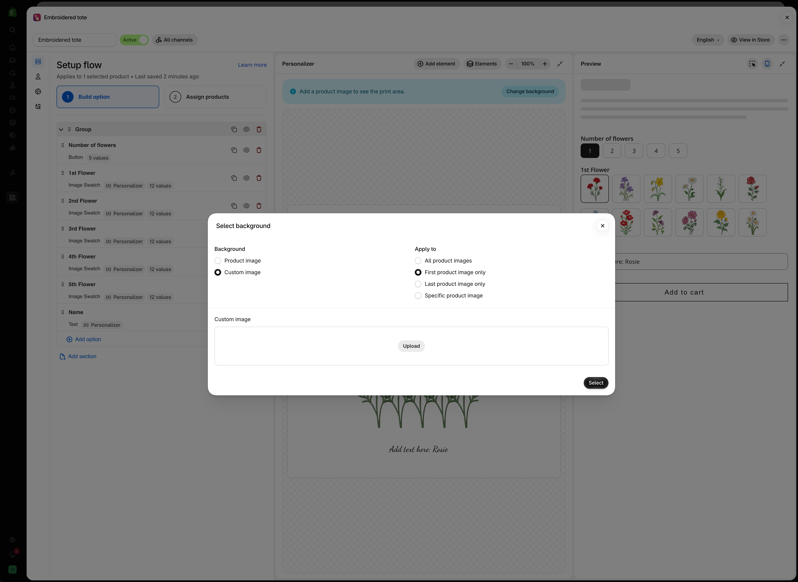

# Set up the Personalizer

This page takes one option from a plain form field to a design printed on the product image, on your live product page. Repeat steps 2 to 6 for every option you want printed.

**Watch it done (1:48).** An engraving field on a necklace, wired to a live preview so the customer reads their own text on the product before checking out.



## Before you start

* An option set with at least one [supported option](personalizer.md#the-twelve-supported-option-types), such as a Text or File upload option. See [Build your options](../option-sets/build-options.md).
* At least one product assigned to the option set, with a clear, front-facing photo. See [Assign to products](../option-sets/assign-to-products.md).
* The [app embed](../getting-started/enable-the-app-embed.md) turned on in your live theme.
* A plan that includes the Personalizer. See [Compare plans](../plans-and-billing/compare-plans.md).

## Steps



### Open the option

Open the option set, go to **Setup flow** > **Build option**, and select the option you want printed on the product.



### Turn on the Personalizer

Select the **Personalizer** tab, next to **Basic** and **Advanced**, and turn on the **Personalizer** switch.

The setting cards below the checkbox become active, the option gets a **Personalizer** badge in the option list, and the Personalizer editor appears. On a wide screen it sits between the settings panel and the **Preview**. On a smaller screen it is a **Personalizer** tab at the top of the preview.

<figure><figcaption>
Until the Personalizer switch is on, the cards below it stay dimmed and nothing is printed for that option.
</figcaption></figure>



### Set the background

Until a background is set, the editor shows **Add a product image to see the print area.** Select **Change background**.

<figure><figcaption>
The editor asks for a background before you position anything.
</figcaption></figure>

In **Select background**:

1. Under **Background**, choose **Product image**.
2. Under **Apply to**, choose which of the product's images shows the design. **First product image only** suits most stores.
3. Select a product to work against, then select **Select**.

<figure><figcaption>
The product you select here is only for working in the editor. On the storefront, each product shows its own photo.
</figcaption></figure>

For the other choices, see [Choosing the background](setup.md#choosing-the-background) below.



### Place the element

Drag the element on the product image to where it should be printed. For exact values, use the **Position and size** card on the **Personalizer** tab.

<figure><figcaption>
Dragging on the canvas and typing values in Position and size change the same settings.
</figcaption></figure>

See [The Personalizer editor](editor.md) for dragging, snapping, zoom, and keyboard nudges.



### Style it

For text, set the color, font size, font, and effect in **Text style**. See [Text style](layer-settings/text-layers.md).

For an image, choose the shape and how the photo fills it in **Shape and fill**. See [Shape and fill](layer-settings/image-layers.md).



### Decide what customers can change

In **What customers can change**, tick what customers may adjust on the product image: **Change position**, **Resize**, or **Rotate**. For text, you can also let them pick the font and color in another option. See [What customers can change](layer-settings/customer-controls.md).

If customers can move or resize the element, turn on **Crop area** in **Print area** so the design stays on the printable part of the product. See [Print area](layer-settings/clip-area.md).



### Add the other options

To print another option, select **Add element** in the editor toolbar and pick the option. Its Personalizer turns on and its settings open, ready to place.



### Test it in the preview

Fill in the form in the **Preview** panel as a customer would. Type text, upload a photo, and pick values. The editor shows the result on the product image. See [Test like a customer](test-like-a-customer.md).



### Save and check your storefront

Select **Save**. Then select **View in Store** in the builder header, and **Preview** next to a product.

The design appears on the product image as customers fill in the form.

<figure><figcaption>
On the storefront, the design is drawn on the product image the customer is viewing.
</figcaption></figure>


If the design appears on your product page, the setup is complete. If it does not, see [Troubleshooting personalizer](troubleshooting.md).




## Choosing the background

The background is the image the design is drawn on. It belongs to the option set, so every element in the set shares it. Open it with **Change background** above the canvas.

### Product image or custom image

<table><thead><tr><th width="200">Background</th><th width="290">What it uses</th><th>Best for</th></tr></thead><tbody><tr><td><strong>Product image</strong></td><td>The product's own photos. You pick one product to work against in the editor. On the storefront, each product uses its own photo</td><td>Most stores. One option set works across many products</td></tr><tr><td><strong>Custom image</strong></td><td>One image you upload, shown instead of the product photo for every product in the option set</td><td>Products that photograph badly, or a clean mock-up that sells better than the real photo</td></tr></tbody></table>

With **Custom image**, select **Upload** and choose your image. **Apply to** then decides which product image your image replaces.

<figure><figcaption>
A custom image replaces the product photo for every product in the option set.
</figcaption></figure>

### Apply to

<table><thead><tr><th width="250">Choice</th><th>Which product image shows the design</th></tr></thead><tbody><tr><td><strong>All product images</strong></td><td>Every image in the gallery</td></tr><tr><td><strong>First product image only</strong></td><td>The first image only</td></tr><tr><td><strong>Last product image only</strong></td><td>The last image only</td></tr><tr><td><strong>Specific product image</strong></td><td>The image at the position you enter, counting from 1</td></tr></tbody></table>


**All product images** is rarely right. An element placed for a front-facing photo lands in the wrong place on close-ups and lifestyle shots.

Choose **First product image only** and keep a front-facing photo first in every gallery. **Specific product image** only works if every product uses the same image order.


What makes a good background photo

<table><thead><tr><th width="290">Do</th><th>Avoid</th></tr></thead><tbody><tr><td>A flat, front-on view of the surface you print on</td><td>Angled shots. Flat text on a slanted surface looks wrong</td></tr><tr><td>Even, soft lighting</td><td>Strong shadows or highlights across the print area</td></tr><tr><td>A plain area where the design sits</td><td>Busy patterns behind the design</td></tr><tr><td>The same framing across products</td><td>Different crops per product when one option set covers many</td></tr><tr><td>A large image that stays sharp</td><td>Small images that blur when enlarged</td></tr></tbody></table>

If your products are photographed at an angle, use a flat **Custom image** mock-up instead.


Positions are percentages of the background. Set the background before you place elements. If you change it later, check every element again.


## What you get by option type

The **Personalizer** tab shows different cards for text and image elements.

<table><thead><tr><th width="290">Card or setting</th><th width="200">Text, Textarea, Number</th><th>File upload and the eight selection types</th></tr></thead><tbody><tr><td><strong>Text style</strong>: color, font size, font style, font family, effect</td><td><strong>Yes</strong></td><td>No</td></tr><tr><td>Curve and auto-fit max width</td><td>Text and Number</td><td>No</td></tr><tr><td>Text alignment</td><td>Textarea</td><td>No</td></tr><tr><td><strong>Shape and fill</strong>: image shape, background mode</td><td>No</td><td><strong>Yes</strong></td></tr><tr><td><strong>What customers can change</strong>: position, size, rotation</td><td><strong>Yes</strong></td><td><strong>Yes</strong></td></tr><tr><td>Font and color from another option</td><td><strong>Yes</strong></td><td>No</td></tr><tr><td><strong>Position and size</strong>: X and Y position, rotation, opacity</td><td><strong>Yes</strong></td><td><strong>Yes</strong></td></tr><tr><td>Width and height</td><td>Textarea</td><td><strong>Yes</strong></td></tr><tr><td><strong>Print area</strong></td><td><strong>Yes</strong></td><td><strong>Yes</strong></td></tr></tbody></table>

Text and Number are single lines, so they get curve and auto-fit instead of a width and height. Textarea is a block, so it gets alignment, width, and height.

## Always give a text element a default value

A text element with no text is not drawn, so the design looks empty until the customer types.

Set a **Default value** on the option's **Basic** tab, such as `Your name` or `Your text here`. The design then always has something to show. The default value is also submitted if the customer leaves it unchanged, so choose wording that makes sense on an order.

Several printed options on one product

All elements are drawn on the same background and can overlap.

<table><thead><tr><th width="290">Combination</th><th>What to check</th></tr></thead><tbody><tr><td>A name and a date</td><td>Different <strong>Y position</strong> values, so they sit on separate lines</td></tr><tr><td>Text over an uploaded photo</td><td>Contrast. Dark text disappears on a dark photo. Consider a <a href="layer-settings/effects.md#stroke">stroke</a></td></tr><tr><td>Two alternative designs, never both</td><td><a href="../conditional-logic/conditional-logic.md">Conditional logic</a>, so only one is visible. A hidden option draws nothing</td></tr><tr><td>Elements that must stay on the printable area</td><td>A <a href="layer-settings/clip-area.md">print area</a> on each one</td></tr><tr><td>Many elements</td><td>Speed on older phones. Keep to what the product needs</td></tr></tbody></table>

What the design is, and is not

<table><thead><tr><th width="290">It is</th><th>It is not</th></tr></thead><tbody><tr><td>A realistic picture of the finished product</td><td>A print-ready proof</td></tr><tr><td>Live, updating as the customer types</td><td>Color-accurate. Screens are not calibrated</td></tr><tr><td>A record of what the customer asked for</td><td>A promise that production matches it exactly</td></tr></tbody></table>

Add a line of [help text](../option-types/shared-settings/placeholder-and-help-text.md#help-text) such as "The preview is a guide. Final placement may vary slightly."

## Notes

* One background per option set. For products framed very differently, use separate option sets.
* Turning the Personalizer off keeps the option working as a normal field and keeps its Personalizer settings for later.
* Settings are per option, so two Text options can look completely different.
* A custom background image is stored with your app files.
* The customer's text or file is always saved on the order. The Personalizer adds an image of the design. See [Designs in cart and orders](cart-and-orders.md).
