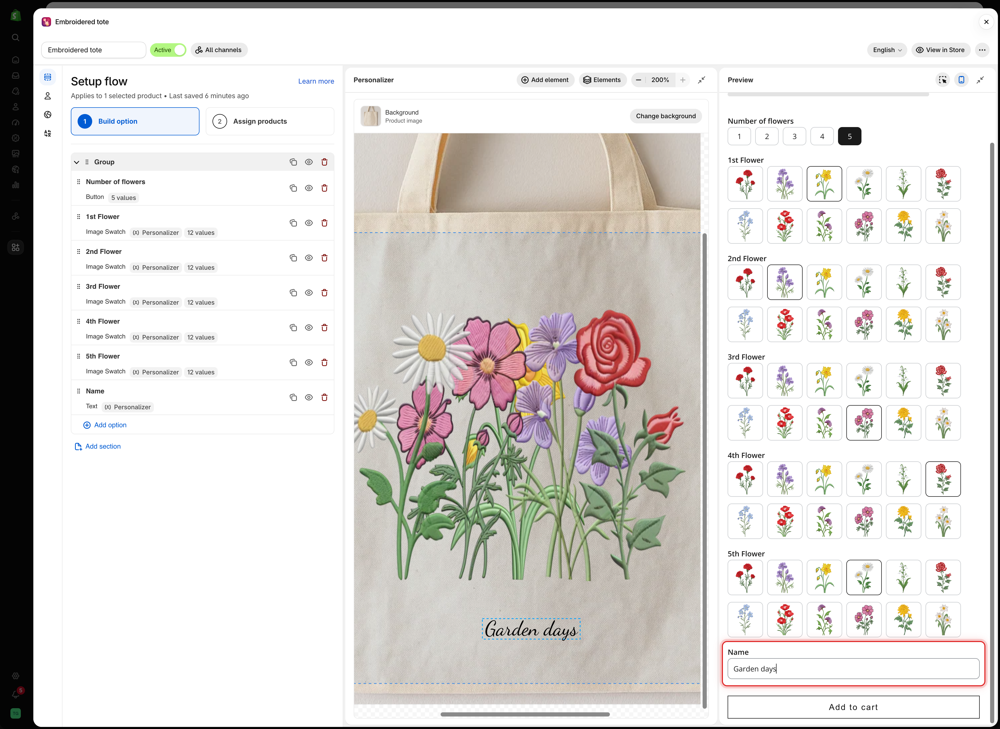
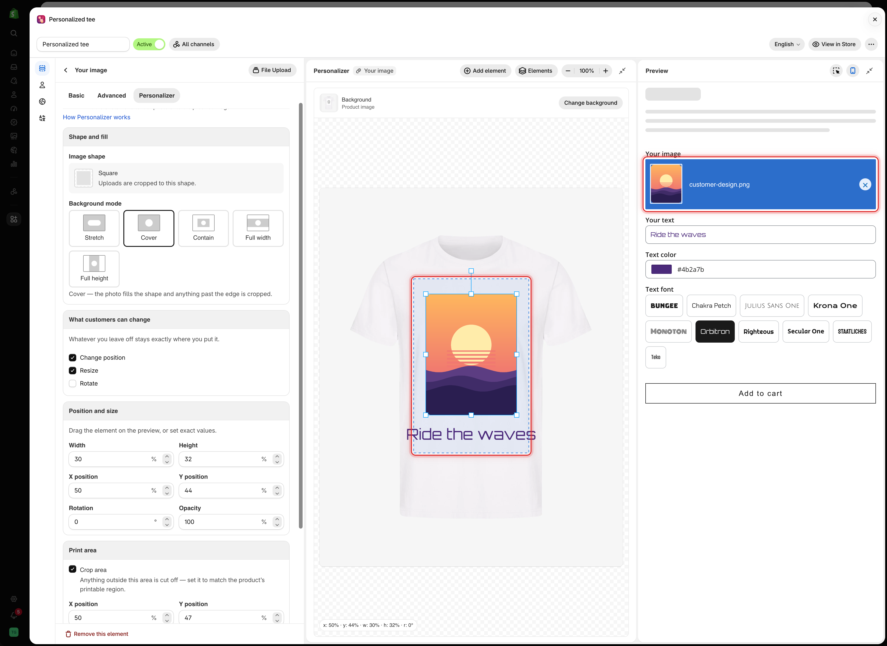

# Test like a customer

The **Preview** form in the builder is connected to the Personalizer editor. Whatever you type, upload, or select in the preview is drawn on the product image, so you can check the design with real content before you publish.

Test values are for checking only. They are not saved with the option set.

## Before you start

* At least one option with the Personalizer turned on, and a background set. See [Set up the Personalizer](setup.md).

## Steps



### Type real text

In the **Preview**, type into each text field. Use a realistic entry, such as a full name rather than `test`. The text replaces the default value on the product image as you type.



### Pick values

Select values in the selection options. Each image element shows the image of the value you picked.

<figure><figcaption>
The flowers and the name chosen in the preview form are drawn on the tote in the editor.
</figcaption></figure>



### Upload a test photo

In a File upload option, select **Choose file** and pick a photo from your computer. It appears inside the element's shape and print area.

The photo stays in your browser. It is not uploaded to your store.

<figure><figcaption>
A photo attached in the preview is placed inside the element's print area, just as a customer's upload would be.
</figcaption></figure>



### Pick a font and a color

If customers choose the font or color in another option, pick a few in the preview. The text on the product image changes with each choice. See [Let customers pick font and color](layer-settings/font-and-color.md).



### Try the extremes

Test the cases that break designs:

* The longest text your **Max character** limit allows.
* A one-character entry.
* A tall photo and a wide photo.
* Every value of each selection option.



### Check desktop view

Select **Show desktop view** in the preview header. The **Option form** tab shows the product image with the design next to the form, as a product page would. See [Desktop view](editor.md#desktop-view).



### Test on your storefront

Save the option set, then select **View in Store**. Repeat the checks on the real product page, and once on a phone.



## What to check

<table><thead><tr><th width="290">Check</th><th>If it fails</th></tr></thead><tbody><tr><td>Long text stays on the product</td><td>Turn on <a href="layer-settings/curve-and-auto-fit.md#auto-fit-max-width">Auto-fit max width</a>, or lower <strong>Max character</strong></td></tr><tr><td>Text is readable on the photo</td><td>Change the color, or add a <a href="layer-settings/effects.md#stroke">stroke</a></td></tr><tr><td>Photos fill the shape without stretching</td><td>Set <strong>Background mode</strong> to <strong>Cover</strong>. See <a href="layer-settings/image-layers.md">Shape and fill</a></td></tr><tr><td>Nothing spills past the printable area</td><td>Turn on <strong>Crop area</strong>. See <a href="layer-settings/clip-area.md">Print area</a></td></tr><tr><td>Elements do not cover each other</td><td>Move one, or use <strong>Elements</strong> to find the hidden one. See <a href="editor.md#elements">Elements</a></td></tr></tbody></table>

## Notes

* Test values are kept while you edit settings, and cleared when you leave the option set.
* The preview uses the product chosen under **Change background**. Each storefront product uses its own photo, so check a few products.
* The builder preview does not use your theme's fonts and spacing. **View in Store** shows the real result.
