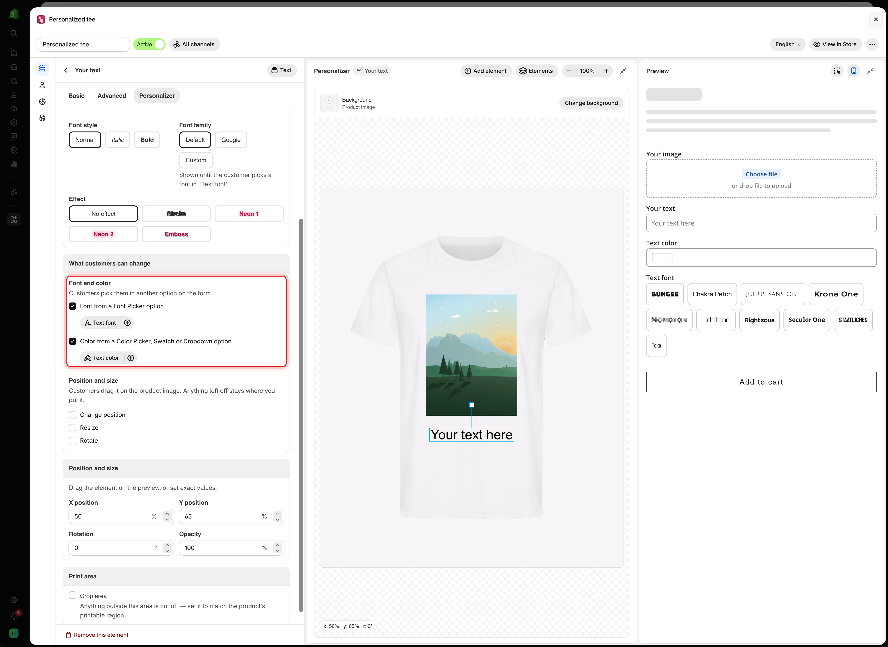
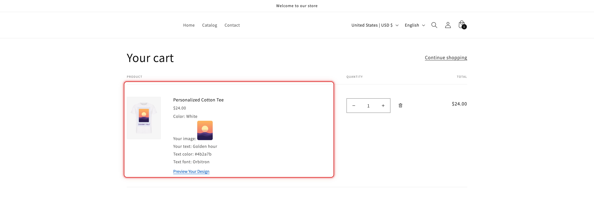

# Walkthrough: personalized t-shirt

This walkthrough builds one complete product: a t-shirt with the customer's photo on the chest and a line of text below it. Customers choose the font and color of the text, and can move and resize their photo inside the print area.

Swap in your own product and wording. The same method works for a tote bag, a hoodie, or a poster.

## Before you start

* A t-shirt product with a clear, front-facing photo first in its gallery. If it has color variants, give each variant its own photo.
* The Personalizer available on your plan. See [Compare plans](../plans-and-billing/compare-plans.md).
* The [app embed](../getting-started/enable-the-app-embed.md) turned on in your live theme.

## Steps



### Create the option set

Go to **Option Sets** > **Create option set** > **Create from scratch** and name it `Personalized tee`. On **Setup flow** > **Assign products**, select your t-shirt. See [Create an option set](../option-sets/create-an-option-set.md).



### Add the photo upload

On **Setup flow** > **Build option**, add a [File upload](../option-types/input-types/file-upload.md) option.

<table><thead><tr><th width="230">Field</th><th width="200">Value</th><th>Why</th></tr></thead><tbody><tr><td><strong>Name on product page</strong></td><td><code>Your image</code></td><td>What customers read</td></tr><tr><td><strong>Required field</strong></td><td>On</td><td>Every shirt needs a photo</td></tr><tr><td><strong>Allowed extensions</strong></td><td><code>jpg</code>, <code>jpeg</code>, <code>png</code></td><td>Files you can print from</td></tr><tr><td><strong>Help text</strong></td><td><code>JPG or PNG, at least 1500 × 1500 pixels.</code></td><td>Sets the quality you need</td></tr></tbody></table>



### Turn on the Personalizer for the photo

Open the option's **Personalizer** tab and turn on the **Personalizer** switch. The Personalizer editor appears.



### Set the background

Select **Change background**. Choose **Product image**, **First product image only**, and your t-shirt, then select **Select**. See [Choosing the background](setup.md#choosing-the-background).



### Shape, place, and limit the photo

On the **Personalizer** tab of `Your image`:

<table><thead><tr><th width="230">Card</th><th width="230">Setting</th><th>Value</th></tr></thead><tbody><tr><td><strong>Shape and fill</strong></td><td><strong>Image shape</strong></td><td><strong>Square</strong></td></tr><tr><td></td><td><strong>Background mode</strong></td><td><strong>Cover</strong></td></tr><tr><td><strong>Position and size</strong></td><td><strong>Width</strong> / <strong>Height</strong></td><td><code>30</code> / <code>32</code></td></tr><tr><td></td><td><strong>X position</strong> / <strong>Y position</strong></td><td><code>50</code> / <code>44</code>, on the chest</td></tr><tr><td><strong>Print area</strong></td><td><strong>Crop area</strong></td><td>On</td></tr><tr><td></td><td><strong>X position</strong> / <strong>Y position</strong></td><td><code>50</code> / <code>47</code></td></tr><tr><td></td><td><strong>Width</strong> / <strong>Height</strong></td><td><code>38</code> / <code>46</code>, the printable area</td></tr></tbody></table>

You can drag the photo and the dashed crop area on the canvas instead of typing values. See [The Personalizer editor](editor.md).



### Let customers frame their photo

In **What customers can change**, tick **Change position** and **Resize**. Leave **Rotate** off.

<figure><figcaption>
With Change position and Resize on, customers can frame their photo, but only inside the crop area.
</figcaption></figure>



### Add the text

Add a [Text](../option-types/input-types/text.md) option below the upload.

<table><thead><tr><th width="230">Field</th><th width="200">Value</th><th>Why</th></tr></thead><tbody><tr><td><strong>Name on product page</strong></td><td><code>Your text</code></td><td></td></tr><tr><td><strong>Max character</strong></td><td><code>20</code></td><td>What fits under the photo</td></tr><tr><td><strong>Default value</strong></td><td><code>Your text here</code></td><td>So the design is never empty</td></tr></tbody></table>

Then select **Add element** in the editor toolbar and pick `Your text`. Drag it below the photo, and set its **Font size** in **Text style**.



### Let customers pick the font and color

On the **Personalizer** tab of `Your text`, in **What customers can change** > **Font and color**:

1. Tick **Font from a Font Picker option**, then select **Add font option**. A Font picker opens. Name it `Text font` and add the fonts customers can choose.
2. Select **Back to Your text**.
3. Tick **Color from a Color Picker, Swatch or Dropdown option**, select **Add color option**, and choose **Color Picker**. Name it `Text color`.
4. Select **Back to Your text**.

<figure><figcaption>
Your text now takes its font from Text font and its color from Text color.
</figcaption></figure>

See [Let customers pick font and color](layer-settings/font-and-color.md).



### Test it in the preview

In the **Preview**, upload a photo, type a line of text, and pick a font and a color. Check that the photo fills the square and the text stays readable.

<figure><figcaption>
Every choice in the preview is drawn on the t-shirt straight away.
</figcaption></figure>

See [Test like a customer](test-like-a-customer.md).



### Save, activate, and check the storefront

Select **Save**. Make sure the option set is **Active** and published to **Online Store**. Then select **View in Store** and **Preview** next to the t-shirt.

<figure><figcaption>
On the product page, customers see their photo and text on the shirt as they fill in the form.
</figcaption></figure>



### Add it to the cart

Select **Add to cart**. The cart line shows the design, every choice, and **Preview Your Design**.

<figure><figcaption>
The cart keeps the design and all the details your team needs to produce it.
</figcaption></figure>

See [Designs in cart and orders](cart-and-orders.md).



## What to change for other products

<table><thead><tr><th width="290">Product</th><th>Change</th></tr></thead><tbody><tr><td>A tote bag</td><td>A larger print area, and image swatches if customers pick designs instead of uploading</td></tr><tr><td>A hoodie</td><td>A smaller print area higher on the chest</td></tr><tr><td>A poster</td><td>A print area covering almost the whole image, and <strong>Contain</strong> if no part of the photo may be cut</td></tr><tr><td>A dark shirt</td><td>A light default text color, or a <a href="layer-settings/effects.md#stroke">stroke</a></td></tr></tbody></table>
