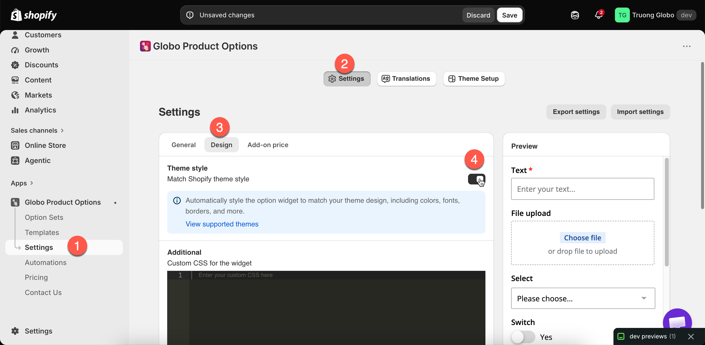

# Match your theme style

**Match theme style** makes the widget use your theme's appearance instead of the app's default styling. On a supported theme, this one setting replaces most of the work of matching the color and typography settings by hand.

Check the setting before you change anything: if your store was running a supported theme when you installed the app, it is already on.

## It may already be on

When you install the app, it looks at your published theme. If that theme is one it has styling for, **Match theme style** is turned on for you, so the widget matches from the start.

This happens **once, at install**. It does not follow you afterwards:

* Switch to a different supported theme later, and you turn the setting on yourself.
* Stores that installed the app before this existed are not changed.
* If anything goes wrong while checking, the setting is simply left off.

## Where it is

**Settings** > **Settings** > **Design** > **Theme style** > **Match theme style**.

Beside the setting is a link to the list of supported themes, which is the list below.

<figure><figcaption>
One switch, and a link to check whether your theme is covered.
</figcaption></figure>

## Supported themes

The app includes styling for these themes. Support is per theme **and per theme version**, and the app uses the closest version it has to the one you are running.

The table is ordered by **ID**, Shopify's theme store ID. It identifies a theme regardless of the name it is sold under, which matters because most themes come in several presets, each with its own name. **Theme** is the theme's name in the Shopify Theme Store; **Also sold as** lists its presets. If you run one of those presets, the styling for that theme applies.

<table><thead><tr><th width="110">ID</th><th width="250">Theme</th><th>Also sold as</th></tr></thead><tbody><tr><td><code>57</code></td><td>Sunrise</td><td>Cabana, Gleam, and Jellybean</td></tr><tr><td><code>141</code></td><td>Fashionopolism</td><td>Haute, Horology, and Salon</td></tr><tr><td><code>230</code></td><td>Expression</td><td>Innovate, Ocean, and Oxford</td></tr><tr><td><code>304</code></td><td>Responsive</td><td>Contour, Cycle, and Patina</td></tr><tr><td><code>459</code></td><td>Vantage</td><td>Monza, Portofino, and Roma</td></tr><tr><td><code>566</code></td><td>Atlantic</td><td>Atrium, Cotton, Parfum, and Plush</td></tr><tr><td><code>567</code></td><td>Mr Parker</td><td>Arena, Nest, and Spa</td></tr><tr><td><code>568</code></td><td>Symmetry</td><td>Amara, Beatnik, Duke, and Salt Yard</td></tr><tr><td><code>606</code></td><td>Blockshop</td><td>Radiance, Stone, and Valla</td></tr><tr><td><code>623</code></td><td>Testament</td><td>Exodus, Genesis, and Revelation</td></tr><tr><td><code>657</code></td><td>Alchemy</td><td>Splice and Weave</td></tr><tr><td><code>677</code></td><td>Showcase</td><td>Aria, Ava, Drake, and Mila</td></tr><tr><td><code>686</code></td><td>Icon</td><td>Dolce, Louis, Vivienne, and Yves</td></tr><tr><td><code>688</code></td><td>Parallax</td><td>Canyon, Dash, and Taproom</td></tr><tr><td><code>691</code></td><td>California</td><td>Anthologist, Disruptor, and Lane</td></tr><tr><td><code>714</code></td><td>Focal</td><td>Ivory, Quartz, and Sapphire</td></tr><tr><td><code>718</code></td><td>Grid</td><td>Ember, Flora, and Knoll</td></tr><tr><td><code>732</code></td><td>Canopy</td><td>Cedar, Magnolia, and Willow</td></tr><tr><td><code>739</code></td><td>Pipeline</td><td>Pahoa, Petra, and Phantom</td></tr><tr><td><code>757</code></td><td>Colors</td><td>Delight and Fluor</td></tr><tr><td><code>777</code></td><td>Palo Alto</td><td>Dynamo, Phenomena, Pluma, and Skylight</td></tr><tr><td><code>801</code></td><td>Flow</td><td>Grain, Nectar, Sanctuary, and Timeless</td></tr><tr><td><code>812</code></td><td>Capital</td><td>Face Value, Mint, Nice Try, and Off Lead</td></tr><tr><td><code>833</code></td><td>Emerge</td><td>Cafe and Elements</td></tr><tr><td><code>836</code></td><td>Venue</td><td>Evening, Morning, Sunset, and Weekend</td></tr><tr><td><code>838</code></td><td>Empire</td><td>Circuit, Depot, and Forma</td></tr><tr><td><code>847</code></td><td>Motion</td><td>Memo and Satchel</td></tr><tr><td><code>849</code></td><td>Modular</td><td>Companion, Kiln, Pattern, and Sparkling</td></tr><tr><td><code>855</code></td><td>Prestige</td><td>Couture, Signature, Strass, and Vogue</td></tr><tr><td><code>857</code></td><td>Impulse</td><td>Apothecary, Dune, and Terrain</td></tr><tr><td><code>859</code></td><td>Cascade</td><td>Phase, Sequence, and Swell</td></tr><tr><td><code>865</code></td><td>Avenue</td><td>Pike and Trail</td></tr><tr><td><code>868</code></td><td>Broadcast</td><td>Airwave, Motif, Relay, and Stellar</td></tr><tr><td><code>871</code></td><td>Warehouse</td><td>Mesh and Wood</td></tr><tr><td><code>887</code></td><td>Dawn</td><td></td></tr><tr><td><code>902</code></td><td>Expanse</td><td>Fetch, Gem, Revive, and Spritz</td></tr><tr><td><code>910</code></td><td>Baseline</td><td>Austere, Brutalist, Courier, and Press</td></tr><tr><td><code>911</code></td><td>Spark</td><td>Foundation and Trendsetter</td></tr><tr><td><code>939</code></td><td>Beyond</td><td>Fleur</td></tr><tr><td><code>1114</code></td><td>Bullet</td><td>Aeris, Bull, Etch, and Nox</td></tr><tr><td><code>1190</code></td><td>Impact</td><td>Balance and Cocoon</td></tr><tr><td><code>1356</code></td><td>Sense</td><td></td></tr><tr><td><code>1363</code></td><td>Crave</td><td></td></tr><tr><td><code>1368</code></td><td>Craft</td><td></td></tr><tr><td><code>1399</code></td><td>Be Yours</td><td>Harmony, Peace, and Sheen</td></tr><tr><td><code>1431</code></td><td>Studio</td><td></td></tr><tr><td><code>1434</code></td><td>Taste</td><td></td></tr><tr><td><code>1457</code></td><td>Tailor</td><td>Lycra and Nylon</td></tr><tr><td><code>1460</code></td><td>North</td><td>Greige, Juice, Pagefold, and Primrose</td></tr><tr><td><code>1499</code></td><td>Colorblock</td><td></td></tr><tr><td><code>1500</code></td><td>Ride</td><td></td></tr><tr><td><code>1535</code></td><td>Shapes</td><td>Aura, Candy, Fizz, and Scratch</td></tr><tr><td><code>1567</code></td><td>Refresh</td><td></td></tr><tr><td><code>1608</code></td><td>Athens</td><td>Apex, Pharm, Prism, and Spoke</td></tr><tr><td><code>1609</code></td><td>Xtra</td><td>Calm, Rover, Seed, and Vault</td></tr><tr><td><code>1611</code></td><td>Zest</td><td>Cosmo, Fleek, Gusto, and Laura</td></tr><tr><td><code>1615</code></td><td>Yuva</td><td>Amaze, Burn, Petal, and Woofy</td></tr><tr><td><code>1621</code></td><td>Stiletto</td><td>Glimmer, Linen, Luster, and Tapestry</td></tr><tr><td><code>1651</code></td><td>Local</td><td>Caffeine, Lively, Soleway, and Thrive</td></tr><tr><td><code>1657</code></td><td>Enterprise</td><td>Homestead and Outlet</td></tr><tr><td><code>1662</code></td><td>Paper</td><td>Parade, Parts, Postcard, and Pull</td></tr><tr><td><code>1667</code></td><td>Avante</td><td>Adelle, Ariste, Bloop, and Vortex</td></tr><tr><td><code>1701</code></td><td>Viola</td><td>Genius, Greenhub, Pinewood, and Thinline</td></tr><tr><td><code>1751</code></td><td>Taiga</td><td>Askel, Bubbly, Hehku, and Meadow</td></tr><tr><td><code>1762</code></td><td>Reformation</td><td>Glamour, Instance, Reinvent, and Sunshine</td></tr><tr><td><code>1765</code></td><td>Stretch</td><td>Diffuse and Snow</td></tr><tr><td><code>1770</code></td><td>Aurora</td><td>Astra, Auriga, Stella, and Vega</td></tr><tr><td><code>1778</code></td><td>Banjo</td><td>Maverick</td></tr><tr><td><code>1790</code></td><td>Erickson</td><td>Hawke and Moksha</td></tr><tr><td><code>1791</code></td><td>Handmade</td><td>Aroma, Habits, Outline, and Porcelain</td></tr><tr><td><code>1819</code></td><td>Whisk</td><td>Afterglow, Bumble, and Greenhouse</td></tr><tr><td><code>1826</code></td><td>Combine</td><td>Bites, Blush, Gadget, and Ring</td></tr><tr><td><code>1829</code></td><td>Creative</td><td>Clarity, Clutch, and Cyan</td></tr><tr><td><code>1839</code></td><td>Blum</td><td>Fable, Fuji, Solie, and Totem</td></tr><tr><td><code>1841</code></td><td>Origin</td><td></td></tr><tr><td><code>1843</code></td><td>Kairo</td><td></td></tr><tr><td><code>1864</code></td><td>Publisher</td><td></td></tr><tr><td><code>1878</code></td><td>Neat</td><td>Limitless, Razor, and Wilderness</td></tr><tr><td><code>1891</code></td><td>Spotlight</td><td></td></tr><tr><td><code>1907</code></td><td>Marble</td><td>Arda and Utro</td></tr><tr><td><code>1918</code></td><td>Abode</td><td>Bramble, Gifter, Javelin, and Velora</td></tr><tr><td><code>1922</code></td><td>Creator</td><td>Enthusiast and Streamer</td></tr><tr><td><code>1924</code></td><td>Portland</td><td>Drip, Self, Timepiece, and Walls</td></tr><tr><td><code>1966</code></td><td>Align</td><td>Darkroom, Playroom, Reset, and Verdant</td></tr><tr><td><code>1974</code></td><td>Atom</td><td>Hydrate and Navigator</td></tr><tr><td><code>1979</code></td><td>Mavon</td><td>Brilliant, Buoyant, Dewy, and Nimble</td></tr><tr><td><code>2048</code></td><td>Eurus</td><td>Arise, Mystique, Placid, and Whiff</td></tr><tr><td><code>2053</code></td><td>Vision</td><td>Onyx, Poochy, Solstice, and Velocite</td></tr><tr><td><code>2073</code></td><td>Area</td><td>Flavor, Medicines, Technical, and Winery</td></tr><tr><td><code>2077</code></td><td>Gain</td><td>Lace, Maison, Mio, and Sable</td></tr><tr><td><code>2101</code></td><td>Fame</td><td>Crystal, Diva, Hunger, and Power</td></tr><tr><td><code>2105</code></td><td>Stockmart</td><td>Bark, Motor, Playground, and Workspace</td></tr><tr><td><code>2117</code></td><td>Sydney</td><td>Affinity, Magazine, Profile, and Vineyard</td></tr><tr><td><code>2138</code></td><td>Berlin</td><td>Adrenaline, Fade, Polarized, and Stereo</td></tr><tr><td><code>2148</code></td><td>Brava</td><td>Lyfted and Rogue</td></tr><tr><td><code>2175</code></td><td>Nostalgia</td><td>Earthy, Pouch, and Scandina</td></tr><tr><td><code>2186</code></td><td>Maranello</td><td>Chroma, Records, and Sneakers</td></tr><tr><td><code>2217</code></td><td>Amber</td><td>Alora and Rascals</td></tr><tr><td><code>2221</code></td><td>Xclusive</td><td>Cozy, Deck, Pace, and Voyage</td></tr><tr><td><code>2239</code></td><td>Woodstock</td><td>Dovrani, Obsidian, and Vita</td></tr><tr><td><code>2240</code></td><td>Next</td><td>Badge, Fleet, Hue, and Rush</td></tr><tr><td><code>2264</code></td><td>Unicorn</td><td>Cargo, Dandy, Illumination, and Sunkissed</td></tr><tr><td><code>2268</code></td><td>Kidu</td><td>Claw, Dresser, Gentle, and Stroll</td></tr><tr><td><code>2275</code></td><td>Pesto</td><td>Cakelet, Juicery, Koffe, and Meatzo</td></tr><tr><td><code>2285</code></td><td>Vivid</td><td>Aero, Beachly, and Pure</td></tr><tr><td><code>2315</code></td><td>Igloo</td><td>Bella and Drift</td></tr><tr><td><code>2316</code></td><td>Minimalista</td><td>Cosmetica, Portfolio, Promise, and Reactive</td></tr><tr><td><code>2319</code></td><td>Beautify</td><td>Cherish and Perk</td></tr><tr><td><code>2328</code></td><td>Cello</td><td>Crescendo, Dazzle, Snitch, and Strings</td></tr><tr><td><code>2358</code></td><td>Toyo</td><td>Leafin, Lumora, Totsy, and Zupet</td></tr><tr><td><code>2405</code></td><td>Urban</td><td>Attire, Floralis, Mechline, and Waverly</td></tr><tr><td><code>2412</code></td><td>Concept</td><td>Inova</td></tr><tr><td><code>2431</code></td><td>Distinctive</td><td>Lineage, Monark, and Playstyle</td></tr><tr><td><code>2481</code></td><td>Horizon</td><td></td></tr><tr><td><code>2491</code></td><td>Borders</td><td>Folio, Mosaic, Objekts, and Readers</td></tr><tr><td><code>2505</code></td><td>Zora</td><td></td></tr><tr><td><code>2514</code></td><td>Aesthetic</td><td>Basics, Flirt, Formula, and Palette</td></tr><tr><td><code>2515</code></td><td>Monk</td><td>Restore and Sea</td></tr><tr><td><code>2534</code></td><td>Takeout</td><td>Crumbs, Orchid, Pantry, and Potion</td></tr><tr><td><code>2546</code></td><td>Noblesse</td><td>Oppulence and Riviera</td></tr><tr><td><code>2566</code></td><td>Veena</td><td>Buddy, Outfit, Spoken, and Uproot</td></tr><tr><td><code>2576</code></td><td>Shine</td><td>Ardent, Energetic, Serene, and Strade</td></tr><tr><td><code>2629</code></td><td>Tokyo</td><td>Novaplay, Paw Prints, and Torque</td></tr><tr><td><code>2684</code></td><td>Wonder</td><td>Nook, Petit, Root, and Velour</td></tr><tr><td><code>2698</code></td><td>Release</td><td>Forest, Grasse, Renaissance, and Serenity</td></tr><tr><td><code>2699</code></td><td>Trade</td><td></td></tr><tr><td><code>2702</code></td><td>Paris</td><td>Desire, Intense, and Passion</td></tr><tr><td><code>2732</code></td><td>Bespoke</td><td>Nature, Splendor, and Workshop</td></tr><tr><td><code>2738</code></td><td>Rise</td><td></td></tr><tr><td><code>2779</code></td><td>Luxe</td><td>Mayfair, Milton, Soho, and Summit</td></tr><tr><td><code>2782</code></td><td>Refine</td><td>Evara, Haula, and Hipster</td></tr><tr><td><code>2801</code></td><td>Nordic</td><td>Luna, Lykke, Perfect, and Wonderland</td></tr><tr><td><code>2821</code></td><td>Sleek</td><td>Glint, Jumped, Modiva, and Wildpeak</td></tr><tr><td><code>2825</code></td><td>Soul</td><td>Boule, Hearth, and Stride</td></tr><tr><td><code>2837</code></td><td>Volume</td><td>Crisp, Laceup, Storm, and Velum</td></tr><tr><td><code>2852</code></td><td>Pinnacle</td><td>Bastion, Everleaf, Patissiere, and Pawmart</td></tr><tr><td><code>2881</code></td><td>Satoshi</td><td>Chalet, Leather, Luma, and Solitaire</td></tr><tr><td><code>2896</code></td><td>Outsiders</td><td>Eccentrics, Misfits, Scandal, and Wrong</td></tr><tr><td><code>2913</code></td><td>Vincent</td><td>Bouquet, Nurture, Oakland, and Pint</td></tr><tr><td><code>2926</code></td><td>Noire</td><td>Binky, Lignum, and Neon</td></tr><tr><td><code>2943</code></td><td>Keystone</td><td>Kaleidoscope, Kettle, Kindred, and Kingpin</td></tr><tr><td><code>2948</code></td><td>King</td><td>Castle, Noor, Regal, and Throne</td></tr><tr><td><code>2967</code></td><td>Ultra</td><td>Grace, Grip, Harbor, and Sprout</td></tr><tr><td><code>2970</code></td><td>Rad</td><td>Feel Good and Nine</td></tr><tr><td><code>2989</code></td><td>Ascent</td><td>Elevated, Joyfy, Livique, and Snout</td></tr><tr><td><code>3001</code></td><td>Koto</td><td>Carnival, Mochi, Rinku, and Spanner</td></tr><tr><td><code>3007</code></td><td>Redefine</td><td>Binderia and Scentella</td></tr><tr><td><code>3027</code></td><td>Ignite</td><td>Alpha, Peak, Playtime, and Tails</td></tr><tr><td><code>3038</code></td><td>Swiss</td><td>Elite</td></tr><tr><td><code>3039</code></td><td>Motto</td><td>Gorgeous, Index, Spin, and Unwind</td></tr><tr><td><code>3051</code></td><td>Boutique</td><td>Aurum, Jade, Noom, and Reflections</td></tr><tr><td><code>3094</code></td><td>Nimbus</td><td>Esselle, Morna, Paletia, and Puddle</td></tr><tr><td><code>3147</code></td><td>Elemento</td><td>Brume, Lunel, and Terra</td></tr><tr><td><code>3223</code></td><td>Ascension</td><td>Aeroform and Opus</td></tr><tr><td><code>3247</code></td><td>Hyper</td><td>Ceramide, Nexvo, Pillar, and Trove</td></tr><tr><td><code>3259</code></td><td>Adorn</td><td>Ace, Choice, Closet, and Precious</td></tr><tr><td><code>3264</code></td><td>Elixira</td><td>Ovelia, Plantella, Sona, and Uno</td></tr><tr><td><code>3269</code></td><td>Normcore</td><td>Elementary, Matte, Raw, and Subtle</td></tr><tr><td><code>3300</code></td><td>Zero</td><td>Printing, Property, Tattoo, and Wag</td></tr><tr><td><code>3385</code></td><td>Strong</td><td>Bend and Velvet</td></tr><tr><td><code>3387</code></td><td>Pastarina</td><td>Buncheeze and Gourmet</td></tr><tr><td><code>3422</code></td><td>Allure</td><td>Bijou, Carrara, Pristine, and Stitch</td></tr><tr><td><code>3425</code></td><td>Monochrome</td><td>Ambition, Capsule, Shade, and Specialty</td></tr><tr><td><code>3440</code></td><td>Loka</td><td>Karma, Kofe, Pour, and Staplr</td></tr><tr><td><code>3470</code></td><td>Sampo</td><td>Carry, Mighty, and Resonance</td></tr><tr><td><code>3486</code></td><td>Edge</td><td>Layer, Linea, Step, and Sundown</td></tr><tr><td><code>3500</code></td><td>Maya</td><td>Citrus and Magic</td></tr><tr><td><code>3520</code></td><td>Nova</td><td>Altair, Lumen, Orion, and Sirius</td></tr><tr><td><code>3530</code></td><td>Fullframe</td><td>Florence and Merida</td></tr><tr><td><code>3533</code></td><td>Lyra</td><td>Bonsai, Glossy, Pixel, and Thread</td></tr><tr><td><code>3560</code></td><td>Triumph</td><td>Tirevo and Toyli</td></tr><tr><td><code>3562</code></td><td>Megastore</td><td>Bride, Fit, Idea, and Makeup</td></tr><tr><td><code>3605</code></td><td>Purity</td><td>Velyn</td></tr><tr><td><code>3620</code></td><td>Pitch</td><td></td></tr><tr><td><code>3621</code></td><td>Atelier</td><td></td></tr><tr><td><code>3622</code></td><td>Fabric</td><td></td></tr><tr><td><code>3623</code></td><td>Dwell</td><td></td></tr><tr><td><code>3624</code></td><td>Heritage</td><td></td></tr><tr><td><code>3625</code></td><td>Ritual</td><td></td></tr><tr><td><code>3626</code></td><td>Savor</td><td></td></tr><tr><td><code>3627</code></td><td>Tinker</td><td></td></tr><tr><td><code>3628</code></td><td>Vessel</td><td></td></tr><tr><td><code>3716</code></td><td>Maximize</td><td>Swift, Tender, Various, and Vigor</td></tr><tr><td><code>3745</code></td><td>Supreme</td><td>Heatwave, Realm, Rose, and Royce</td></tr><tr><td><code>3754</code></td><td>Krank</td><td>Drive, Eyra, Feast, and Florona</td></tr><tr><td><code>3773</code></td><td>Stockist</td><td>Optic, Porter, Residence, and Verve</td></tr><tr><td><code>3784</code></td><td>Vetro</td><td>Arrok and Gario</td></tr><tr><td><code>3802</code></td><td>Zyra</td><td>Matrix</td></tr><tr><td><code>3805</code></td><td>Unity</td><td>Liora</td></tr><tr><td><code>3820</code></td><td>Mix</td><td>Camp, Casa, Moda, and Watt</td></tr><tr><td><code>3830</code></td><td>Victory</td><td>Athletica, Flip, Nitro, and Roast</td></tr><tr><td><code>3867</code></td><td>Poetic</td><td>Bavery, Lunara, Sonnet, and Turner</td></tr><tr><td><code>3872</code></td><td>Zenith</td><td>Artify, Batch, Escapism, and Perspective</td></tr><tr><td><code>3873</code></td><td>Metro</td><td>Beam and Clove</td></tr><tr><td><code>3904</code></td><td>Fit Check</td><td>Destill and Relic</td></tr><tr><td><code>3907</code></td><td>Poco</td><td>Elmora and Techmart</td></tr><tr><td><code>3955</code></td><td>Filo</td><td>Bookie, Instep, and Soothe</td></tr><tr><td><code>4020</code></td><td>Venice</td><td>Arcane</td></tr><tr><td><code>4032</code></td><td>Pebble</td><td>Bunie, Framia, Rawjoy, and Wellina</td></tr><tr><td><code>4036</code></td><td>Zeal</td><td>Evolve, Petzen, Pulse, and Versatile</td></tr><tr><td><code>4041</code></td><td>Athora</td><td>Evon, Nuxio, Planti, and Quantum</td></tr><tr><td><code>4050</code></td><td>Homage</td><td>Embrace</td></tr><tr><td><code>4091</code></td><td>Elegance</td><td>Brave, Lipsora, Oria, and Popzy</td></tr><tr><td><code>4098</code></td><td>Zap</td><td>Fluff, Portable, Rays, and Refuel</td></tr><tr><td><code>4109</code></td><td>Purevea</td><td>Wayward</td></tr><tr><td><code>4131</code></td><td>Vows</td><td>Crimson and Tuxedo</td></tr><tr><td><code>4133</code></td><td>Dynamic</td><td>Regalia, Reliable, Rich, and Sophie</td></tr><tr><td><code>4141</code></td><td>Snazzy</td><td>Frond, Kibble, Snugly, and Varnish</td></tr><tr><td><code>4156</code></td><td>Prompt</td><td>Bookmark, Imagine, Rapid, and Visage</td></tr><tr><td><code>4239</code></td><td>Shift</td><td>Aqua, Feelings, Prototype, and Reserve</td></tr><tr><td><code>4244</code></td><td>Noble</td><td>Automobile, Fold, Gemstone, and Glide</td></tr><tr><td><code>4267</code></td><td>Nexus</td><td>Arcade, Delicious, Lumia, and Vestra</td></tr><tr><td><code>4276</code></td><td>Helix</td><td>Elvara, Marlow, Norda, and Selene</td></tr><tr><td><code>4292</code></td><td>Arctos</td><td></td></tr><tr><td><code>4301</code></td><td>Agnes</td><td>Seoul and Tyche</td></tr><tr><td><code>4390</code></td><td>Mivo</td><td>Andie and Woody</td></tr><tr><td><code>4496</code></td><td>Wave</td><td>Kiddorie, Peaches, Renaisse, and Tonic</td></tr><tr><td><code>4506</code></td><td>Renovate</td><td>Greenscape, Industrial, Portrait, and Vector</td></tr><tr><td><code>4518</code></td><td>Kinderly</td><td></td></tr><tr><td><code>4570</code></td><td>Ormonte</td><td>Cafeone and Scentia</td></tr><tr><td><code>4693</code></td><td>Epitome</td><td>Daydream, Forever, Monogram, and Privilege</td></tr><tr><td><code>4700</code></td><td>Strada</td><td>Amore, Angelo, Lusso, and Perla</td></tr><tr><td><code>4738</code></td><td>Awaken</td><td>Essenken and Greenley</td></tr><tr><td><code>4798</code></td><td>Stack</td><td>Gardenia, Lager, Setup, and Workbench</td></tr><tr><td><code>4816</code></td><td>Voltix</td><td>Elara, Fresh, Minimal, and Scarlet</td></tr><tr><td><code>4874</code></td><td>Majestic</td><td>Coral and Iconic</td></tr><tr><td><code>4920</code></td><td>Gravity</td><td>GenZ</td></tr><tr><td><code>4961</code></td><td>Stylist</td><td>Gateau, Modulux, and Tranquil</td></tr><tr><td><code>5010</code></td><td>Soft</td><td>Graceful, Merit, Pearl, and Twinkle</td></tr><tr><td><code>5021</code></td><td>Adam</td><td>Edward, Kiyoshi, Leon, and Marcus</td></tr><tr><td><code>5077</code></td><td>Analog</td><td>Anthem</td></tr><tr><td><code>5231</code></td><td>Radian</td><td>Fearless and Peony</td></tr><tr><td><code>5357</code></td><td>Egoiste</td><td>Femme, Illusion, Monde, and Sentiment</td></tr><tr><td><code>5359</code></td><td>Fuse</td><td>Bond, Clio, Fluid, and Node</td></tr><tr><td><code>5560</code></td><td>Sky</td><td>Bliss and Fuel</td></tr><tr><td><code>5665</code></td><td>Miro</td><td>Cielo, Estrella, Menta, and Perro</td></tr><tr><td><code>5679</code></td><td>Tide</td><td>Altitude, Chronicle, Finish, and Posy</td></tr><tr><td><code>5798</code></td><td>Attitude</td><td>Range, Recovery, Scent, and Sync</td></tr></tbody></table>

If your theme is not listed, see [If your theme is not supported](match-your-theme-style.md#if-your-theme-is-not-supported) below.


The list is updated over time. If your theme is not listed here, check the **View supported themes** link beside the setting.


## What it does

With the setting on, the widget takes its input and button styling, control shapes, and typography from your theme rather than from the app's defaults.

The widget then looks like part of the product page rather than a separate form.

## What it does not do

<table><thead><tr><th width="290">Not covered</th><th>Where to handle it</th></tr></thead><tbody><tr><td>Where the widget sits on the page</td><td><a href="widget-placement.md">Widget placement</a></td></tr><tr><td>Behavior — tooltips, height limits, selected values</td><td><a href="widget-behavior.md">Widget behavior</a></td></tr><tr><td>Anything specific to your own customizations of the theme</td><td><a href="custom-css.md">Custom CSS</a></td></tr><tr><td>The builder's preview panel</td><td>Nothing — the preview always uses the app's own styling. Compare with <strong>View in Store</strong></td></tr></tbody></table>

## Steps



### Turn on Match theme style

**Settings** > **Settings** > **Design** > **Theme style**.



### Save



### Check a real product page

Use **View in Store** from the builder. The builder preview does not display the change because it never uses your theme's styling.



### Adjust anything that is left

Use the [color](colors.md), [border, and typography](borders-and-typography.md) settings, which continue to work alongside this one.



### Check on a phone

Check the widget again after any theme update.



## If your theme is not supported

Turning the setting on causes no problems. The widget keeps the app's own styling. Style it manually instead:



### Match your fonts

**Settings** > **Design** > **Typography**. Set the four text styles to your theme's fonts and sizes. See [Borders and typography](borders-and-typography.md).



### Match your colors

**Settings** > **Design** > **Color**. Copy the values from your theme's own settings so they match exactly. See [Colors](colors.md).



### Match your border weight and radius

Also in **Design**. Rounded controls in a theme with square controls are the most noticeable mismatch.



### Fill any gaps with custom CSS

See [Custom CSS](custom-css.md).



### Or contact support

Support can help with theme styling. See [Contact support](../help/contact-support.md).



## Notes

* This setting is store-wide, like everything in **Design**.
* Support is per theme version, and the app uses the nearest version it has. A very old or very new version of a supported theme may match less closely.
* A heavily customized copy of a supported theme may not match, because the app styles the original theme rather than your changes.
* Color, border, and typography settings still apply, so you can turn this on and then adjust them.
