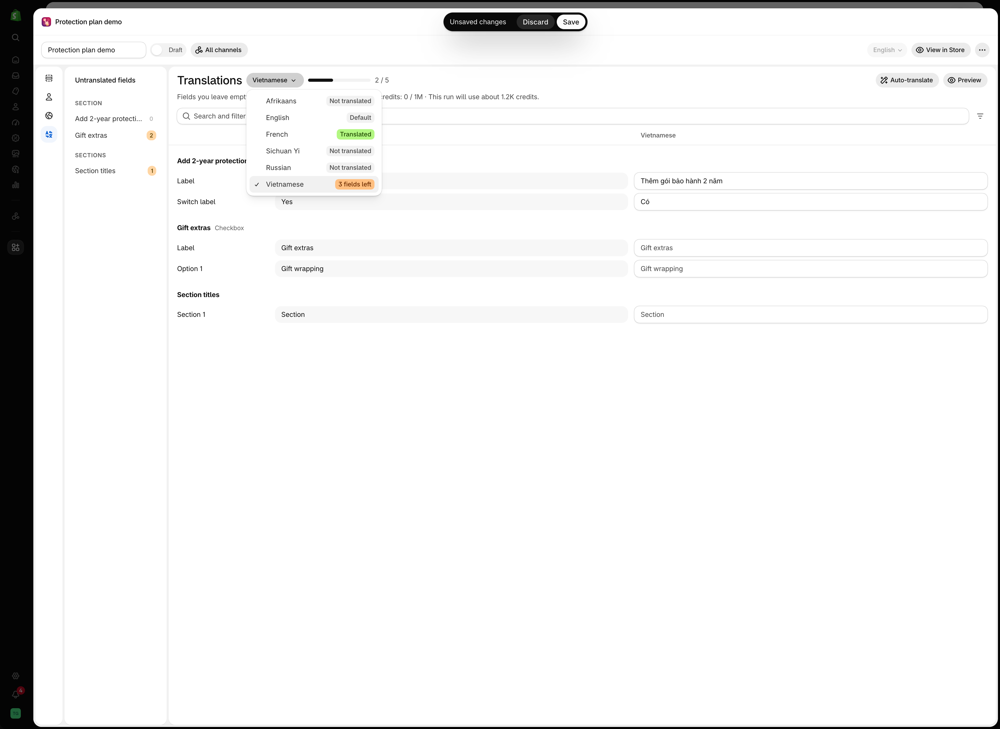
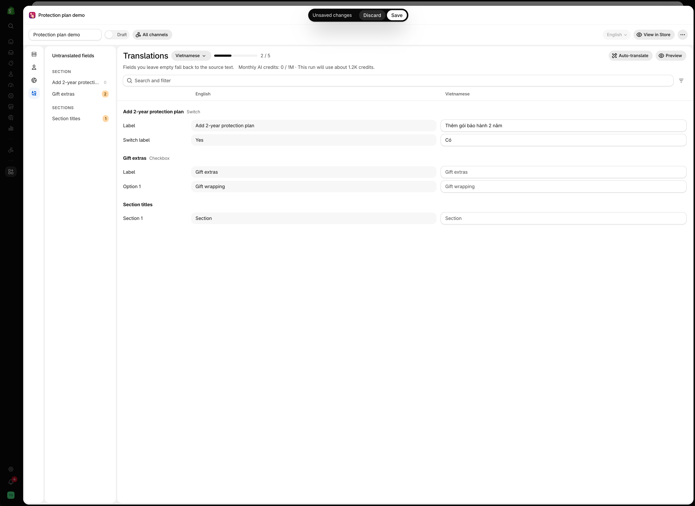
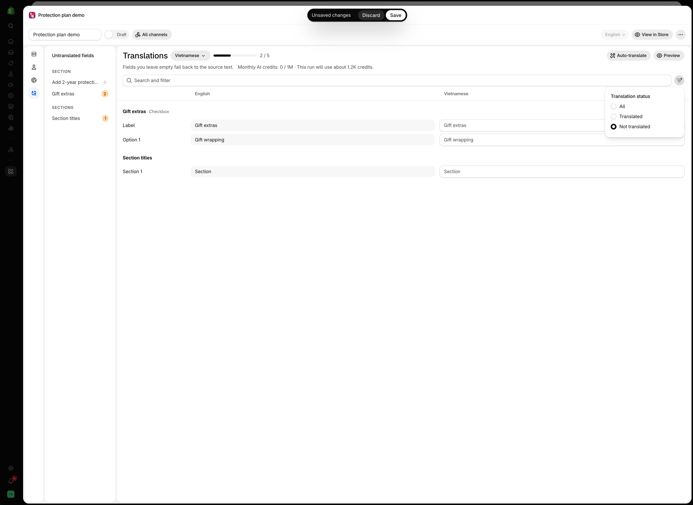
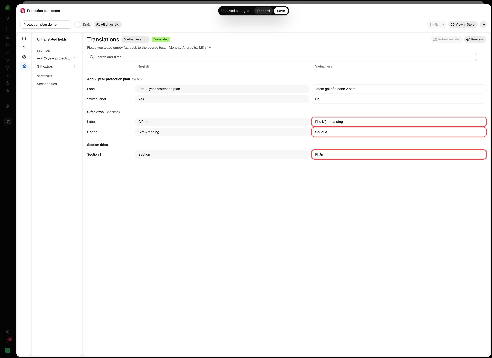

# Translate option content

Option content is the text you wrote: labels, option values, help text, placeholders, and static content such as paragraphs and size charts. Each of these can be translated for each storefront language.

## Before you start

* Your storefront needs more than one language, configured in Shopify. The app reads the list from there.
* Translating option content may not be available on all plans. If the **Translations** panel is locked, see [Compare plans](../plans-and-billing/compare-plans.md).
* Translate the [widget text](translate-widget-text.md) for the store first. It is quicker, and it covers the messages that appear in every option set.

## Steps

Translation is done per option set, in the **Translations** panel of the option set editor. It is the last icon in the editor's left sidebar, below **Setup flow**, **Customers**, and **Countries**.



### Open the option set and select **Translations**

The panel opens on your default language, marked **Default**, with the note *Every other language is translated from this text.* The fields on this view are your source text. Editing one here changes the option itself.



### Pick a language from the menu beside **Translations**

The menu lists every language your store sells in. Each one has a status badge:

<table><thead><tr><th width="250">Badge</th><th>Meaning</th></tr></thead><tbody><tr><td><strong>Default</strong></td><td>Your source language. Every other language is translated from it</td></tr><tr><td><strong>Translated</strong></td><td>Every field has a translation</td></tr><tr><td><code>3 fields left</code></td><td>Partly translated. The number is how many fields are still empty</td></tr><tr><td><strong>Not translated</strong></td><td>No field has been translated yet</td></tr></tbody></table>

<figure><figcaption>
The language menu shows the status of every language, so you can see what is left without opening each one.
</figcaption></figure>



### Fill in the fields

Each row shows the field name, the source text in your default language, and the field for the language you picked. An empty field shows the source text in grey. That is also what customers see until you translate it.

Rows are grouped by option, with the option type beside its name, and section titles come last under **Section titles**. Fields are named by what they are and where they sit: `Label`, `Help text`, `Placeholder`, `Option 1` for the first value, `Tab 1`, `Condition 1`, and `Section 1`.

Beside the language menu, a progress bar counts the translated fields, such as `2 / 5`. It turns into a **Translated** badge once every field is filled in.

<figure><figcaption>
Vietnamese, two of five fields translated. Empty fields show the English source text in grey.
</figcaption></figure>



### Find what is left

The **Untranslated fields** column on the left lists every option, grouped by section, with the number of fields still empty in each. Select an option to jump to it.

To narrow the list, type in **Search and filter**. It matches option names, field names, and source text. The filter button beside it sets **Translation status** to **All**, **Translated**, or **Not translated**.

<figure><figcaption>
With Translation status set to Not translated, only the fields still to do are listed.
</figcaption></figure>



### Check it with **Preview**

**Preview** takes you back to the editor, with the live preview shown in the language you were translating.



### Pick the next language and repeat

The badges in the language menu update as you go.



### Save, then test on each storefront

Switch language on your storefront and work through the product page in each one.




Fields you leave empty fall back to the source text, so a partly translated language still works on your storefront.


## Auto-translate

**Auto-translate** fills in the empty fields of the language you have picked, so you review and correct rather than type everything. The button is at the top right of the panel, beside **Preview**. It does not appear on your default language, because there is nothing to translate it into.



### Pick the language you want to translate

Auto-translate works on one language at a time, and only on fields that are still empty. It never overwrites a translation you have already written.



### Check the estimate

The line below the title reads, for example, `Monthly AI credits: 1.1K / 1M · This run will use about 1.2K credits.` The button is unavailable when there is nothing left to translate.



### Select **Auto-translate**

Progress replaces the credit line while it runs: `Translating 3 fields…` for a short option set, or `Translated 18 of 42 fields` for a longer one. A **Stop** button appears beside **Auto-translate**. The language menu and **Preview** wait until the run ends.



### Read the result and correct it

When it finishes, a short message confirms it, such as `Auto-translate finished. 3 fields translated.` Machine output still needs a read-through, particularly for product names, materials, and anything you have a house term for.

<figure><figcaption>
Auto-translate filled the three empty fields and kept the two typed by hand. With nothing left, the button is unavailable.
</figcaption></figure>



### What it skips

<table><thead><tr><th width="330">Skipped</th><th>Why, and what to do</th></tr></thead><tbody><tr><td>Fields you have already translated</td><td>Auto-translate only fills empty fields</td></tr><tr><td>Fields that are too long</td><td>Reported as <code>:count fields were skipped because they are too long to translate automatically.</code> Translate those by hand</td></tr><tr><td>Condition values</td><td>Reported as <code>:count condition values are left for you to translate by hand.</code> These have to match your Shopify variant names exactly, so they are never guessed. See <a href="translate-option-content.md#variant-conditions-need-translating-too">Variant conditions need translating too</a></td></tr></tbody></table>

When something is skipped, the result stays on screen as a banner rather than a short message, so you can read which fields to finish by hand.

### Monthly AI credits

Auto-translate runs on a monthly credit allowance that comes with your plan.

<table><thead><tr><th width="290">What you see</th><th>What it means</th></tr></thead><tbody><tr><td><code>Monthly AI credits: 1.1K / 1M</code></td><td>How much of this month's allowance you have used. The line turns amber once you pass 80%</td></tr><tr><td><code>This run will use about 1.2K credits</code></td><td>An estimate for the language you are about to translate, shown before you start</td></tr><tr><td><code>Monthly AI credits used up</code></td><td>The allowance is spent. <strong>Auto-translate</strong> is unavailable until it resets at the start of next month. Translating by hand still works</td></tr></tbody></table>

Credits are counted per run, not per language, so translating a short option set costs far less than a long one. The allowance is shared across your whole store, and the exact number depends on your plan. See [Compare plans](../plans-and-billing/compare-plans.md).


Credits are spent as the work is done. If you **Stop** a run part-way, the fields already translated are kept, and so is the cost of translating them.


### If it stops early

<table><thead><tr><th width="330">Message</th><th>What to do</th></tr></thead><tbody><tr><td>A translation is already running for this option set.</td><td>Wait for the other run to finish. Only one run per option set at a time, even across browser tabs</td></tr><tr><td>Too many translation requests. Resuming in <code>0:12</code>…</td><td>Nothing. The run pauses for the time shown, then carries on by itself</td></tr><tr><td>Too many translation requests. Try again in <code>:count</code> seconds.</td><td>The pause was not enough. Wait the number of seconds shown, then select <strong>Try again</strong></td></tr><tr><td>Translation timed out. The fields already translated were kept.</td><td>Select <strong>Try again</strong> to continue with the rest</td></tr><tr><td>Auto-translate stopped. <code>:count</code> of <code>:total</code> fields were translated.</td><td>You selected <strong>Stop</strong>. Select <strong>Try again</strong> to finish the rest</td></tr><tr><td>Translated <code>:count</code> of <code>:total</code> fields. The rest could not be translated.</td><td>Select <strong>Try again</strong> for the remaining fields</td></tr><tr><td>Auto-translate is temporarily unavailable. Please try again later.</td><td>A problem on the translation service. Try again later</td></tr><tr><td>Auto-translate failed. Please try again.</td><td>Select <strong>Try again</strong>. If it keeps happening, see <a href="../help/contact-support.md">Contact support</a></td></tr></tbody></table>

A run that stops part-way keeps everything it had already translated, and **Try again** picks up from what is still empty.


Auto-translate may not be available on all plans. On a plan without it, the button opens **Pricing**. See [Compare plans](../plans-and-billing/compare-plans.md).


## What can be translated

<table><thead><tr><th width="290">Translatable</th><th>Not translatable</th></tr></thead><tbody><tr><td>Option <strong>Label</strong></td><td>Option <strong>Name</strong> — deliberately, so orders stay consistent</td></tr><tr><td>Option values</td><td>Prefix and suffix text</td></tr><tr><td><strong>Help text</strong>, at option and value level</td><td>Option set names</td></tr><tr><td><strong>Placeholder</strong></td><td>Add-on product titles — translate those in Shopify</td></tr><tr><td>Static content: Heading, Paragraph, Pop-up modal, HTML, Size chart, Tabs</td><td>The <code>globo-product-options</code> tag and other internal values</td></tr><tr><td>Conditional logic values for <strong>Shopify variant</strong> conditions</td><td>Conditions that test your own option values — they compare the source value</td></tr><tr><td>Section titles</td><td></td></tr></tbody></table>

## Two things to be aware of

### Option Name stays in one language

The **Name** appears on the cart, the order, and your packing slips. It is intentionally not translatable, so your production team reads `Engraving text` regardless of the language the customer ordered in.

This is why a customer's cart can show English text on a translated storefront. See [Label and Name](../option-types/shared-settings/labels-and-visibility.md).

### Variant conditions need translating too

If you use [conditions based on Shopify variants](../conditional-logic/conditions-on-shopify-variants.md), the variant name you entered is stored **for each language**, because variant names are translated as well.

A rule that works on your English storefront does not run on your French storefront until the French variant name is entered too. These values appear in the **Translations** panel like any other field, labelled `Condition 1`, `Condition 2`, and so on, so they are listed with everything else rather than hidden inside the rule builder.

This is the most common cause of conditional logic not working on a translated storefront.

Conditions that test one of **your own** option values are not translated. They compare against the source value, so they keep working in every language.

## Keeping translations in step

<table><thead><tr><th width="290">When you</th><th>Remember to</th></tr></thead><tbody><tr><td>Add an option</td><td>Translate it in every language before going live</td></tr><tr><td>Add an option value</td><td>Same — an untranslated value shows in your primary language</td></tr><tr><td>Rename an option value</td><td>Update the translation, and check any conditional rule that referenced it</td></tr><tr><td>Change help text</td><td>Update every language, or the languages drift apart</td></tr><tr><td>Add a storefront language in Shopify</td><td>Go through every option set for the new language</td></tr></tbody></table>

Finish an option set completely in your primary language, then translate it in one pass. Translating while you build means repeating the work every time you change something.

## Notes

* Untranslated fields fall back to the source text rather than displaying blank, so a partially translated store still works.
* **Preview** displays the option set in the selected language, which is the quickest way to check a translation in context.
* Option values keep their character rules in every language. The characters `,` `:` `"` `'` `|` are not allowed. See [Working with option values](../option-sets/option-values.md).
* CSV export includes translations, so you can move a translated option set between stores. See [Import and export](../option-sets/import-and-export.md).
